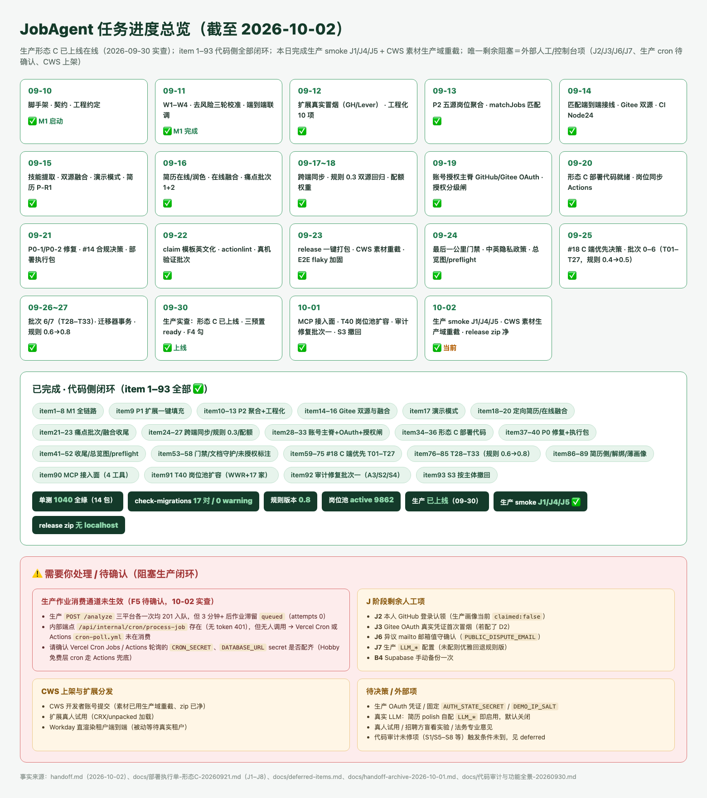

# Handoff

JobAgent 当前状态，截至 2026-10-31。

> 本文件只保留「项目当前状态 + 活跃任务 + 最近变更 + 文档索引」，是接手（人或 AI agent）的第一入口；**只写状态与结论，明细一律放进对应文档并在此给链接，不在本文件展开**。
> 设计/结论全文放 [docs/](docs/)；缓做事项放 [docs/deferred-items.md](docs/deferred-items.md)；场景化导航见 [docs/README.md](docs/README.md)。
> **归档惯例（对齐 agent-world，2026-09-18 起执行）**：①本文件只保留「项目当前状态 + 活跃任务 + 最近 5 条变更 + 文档索引」；②编号待办标 ✅ 后，详细过程（实现步骤 / commit 链 / 踩坑 / 验证数据）整块滚入 `docs/handoff-archive-YYYY-MM-DD.md`，本文件只留**一行结论 + commit hash**；③真正在推进 / 还在跑的活跃项保留详情。归档文件冻结只读、不再追加。

## Project documents

📚 **文档地图（按场景怎么读 + 状态约定）**：[docs/README.md](docs/README.md)。以下为全部文档直达（本区是完整清单的单一事实源，docs/README 只做场景导航、不重复清单）：

- [README.md](README.md) — 项目门面、技术栈、规划命令、铁律
- [AGENTS.md](AGENTS.md) — AI coding agent 工程约定单一事实源（CLAUDE.md 仅引用它）
- [CONTRIBUTING.md](CONTRIBUTING.md) — 本地开发 / 测试 / 提交 / PR 统一要求
- [MIGRATION_CONVENTION.md](MIGRATION_CONVENTION.md) — 数据库迁移命名/文件头/幂等/回滚规范
- [git-commit-message.md](git-commit-message.md) — 英文原子 Conventional Commits 规范
- [PULL_REQUEST_WORKFLOW.md](PULL_REQUEST_WORKFLOW.md) — 分支职责、PR 评审与合并流程
- [docs/产品构想-以GitHub为桥梁的招聘系统.md](docs/产品构想-以GitHub为桥梁的招聘系统.md) — 原始构想：定位、市场、B/C 双向闭环（历史）
- [docs/讨论记录-01-切入口与MVP收敛-20260910.md](docs/讨论记录-01-切入口与MVP收敛-20260910.md) — 切入口、护城河、L0–L4 分层、MVP 收敛过程（历史）
- [docs/讨论记录-02-投递功能与竞品分析-20260911.md](docs/讨论记录-02-投递功能与竞品分析-20260911.md) — 投递功能方向、Jobright 深度竞品分析、四种技术路径对比、职位聚合/Chrome 扩展可行性、3 项待决策（历史）
- [docs/design-competitive-positioning-20261008.md](docs/design-competitive-positioning-20261008.md) — 竞争定位（现行）：差异化＝可核验行为证据画像 vs 通用生成；三杠杆＝"能力证明层"叙事/数据飞轮/B 端变现；含定位图与对外一话版本
- [docs/design-websearch-job-discovery-20261008.md](docs/design-websearch-job-discovery-20261008.md) — 指令式全网搜岗（websearch）设计：双模式（定时采集保留 + 用户指令主动全网搜岗）、SearchPreset/SearchRun 数据模型、API 草案、LLM 角色表（意图解析/JD 抽取 LLM fail-closed；匹配/去重/状态机永远规则引擎）、搜索通道对比（Tavily 主 / SerpAPI/Brave 备）、风险对策、P0/P1/P2 分期（现行，**P0 已落地 2026-10-08**）
- [docs/design-ui-polish-20261010.md](docs/design-ui-polish-20261010.md) — **UI 定向升级方案（2026-10-10，P0/P1/P2/V5 全批次已于同日落地）**：生产三页面实测（首页/报告页/工作台）——信息架构/证据链/合规文案为强项，视觉层定向升级而非重做；V1 宽屏栅格（1280 内容列 ~43%→72%，落为 `--ja-container-max: 72rem`）+ V3 报告页章节锚点导航（`ReportToc.tsx`）＝P0；V2 品牌主色/真实性分级三通道（颜色+图标+文字）P1；V4 工作台空态引导（`EmptyState.tsx`）+ 未认领横幅强化 P2；V5 响应式抽样（360/753 两档六页面零横向溢出）；硬约束＝不换体系、不改文案口径、不碰接口契约；主色基调沿用绿-teal（已拍板）
- [docs/PRD.md](docs/PRD.md) — 产品范围、F1–F9、AbilityProfile/EvidenceItem 契约、指标、风险 ★
- [docs/技术选型-MVP-20260910.md](docs/技术选型-MVP-20260910.md) — 技术栈选型、运行架构、目录规划、M1 排期与 Spike ★
- [docs/技术栈总览-分层架构-20260916.md](docs/技术栈总览-分层架构-20260916.md) — 当前技术栈分层架构一页总览：客户端/服务/内核/采集/持久化五层、各包职责、横切事实与数据流（现行，与 AGENTS/README 同步）
- [docs/市场调研-AI求职赛道-20260910.md](docs/市场调研-AI求职赛道-20260910.md) — AI 求职赛道市场调研：市场格局、功能全景、代表性产品画像、信任风险与 P0/P1/P2 跟进建议（现行）
- [docs/市场与竞品更新-20261003.md](docs/市场与竞品更新-20261003.md) — 赛道月度更新（2026-10）：融资加速（HiringCafe/Jack&Jill/Spott/Juicebox 等）、巨头入场（LinkedIn Hiring Assistant 2 / OpenAI Jobs Platform 传闻 / GitHub Skills 徽章）、「GitHub 行为证据」新玩家（GotSkillz/Checkmarked/SkillMD）与对 JobAgent 迭代方向的机会/威胁/跟进建议（现行，item98）
- [docs/市场调研-招聘市场痛点-20260916.md](docs/市场调研-招聘市场痛点-20260916.md) — 中国招聘市场双方痛点调研：企业端（寻源/筛选/造假/误聘）与求职者端（反馈缺失/定位模糊/竞争加剧）量化痛点、共同根源与对 JobAgent 的可信信号启示（现行）
- [docs/设计-痛点解决方案-20260916.md](docs/设计-痛点解决方案-20260916.md) — 12 项痛点→解决方案对位表 + 实施批次拆分：批次1 纯产品化（企业核验视图/面试准备包/落地页文案）、批次2 新接口（人才检索/筛选工作台/投递追踪）、批次3 外部条件；**批次 1 代码项 + 批次 2 已于 2026-09-16 落地（见 item21，落地页文案在独立仓未改、批次3 待外部条件）**（现行）
- [apps/extension/README.md](apps/extension/README.md) — P1 浏览器扩展试用指南：本地服务、开发者模式加载、Greenhouse/Lever 一键填充步骤与已知限制（现行）
- [docs/待拍板决策清单-20260910.md](docs/待拍板决策清单-20260910.md) — #1–#21；#1–#8 已决策（#4 当日修订为海内外同步），#9–#13 延后，#14 已于 2026-09-21 决策，#15/#16 已定（扩展 P1、职位聚合 P2），**#16 扩展（websearch 指令式全网搜岗）已于 2026-10-08 拍板并 P0 落地**（Tavily 主通道、其他 API 备选、优先级插队；见 design-websearch 文档），#17/#18 已于 2026-09-25 决策（#17 分期、#18 四期 C-A→C-D），**#19 MCP 接入面已于 2026-10-01 决策并落地**（三子问按建议：引 SDK 仅装 `apps/mcp`·stdio、fail-closed、v0 不给证据外链；见 item90 与 `apps/mcp`），**#20 求职 Agent 阶段 2/3 边界已于 2026-10-03 决策**（四条全采纳建议：填完等用户点提交 / 快照暂不落库 / 复盘 ≥20 条带结果才生效 / 披露 AI 辅助投递标识；见 item95），**#21 LLM 模型供给已于 2026-10-03 拍板并 P0 落地**（内置 Admin UI + BYOK 服务端加密、凭证 env only；见 item102–105 与 `docs/design-llm-model-provisioning-20261003.md`）
- [docs/deferred-items.md](docs/deferred-items.md) — 缓做/低优事项登记表（挂起项 + 触发条件的单一事实源）
- [docs/handoff-archive-2026-09-19.md](docs/handoff-archive-2026-09-19.md) — handoff 历史归档（2026-09-19）：item28 账号授权主脊（GitHub OAuth 登录/会话/认领）明细 + item29 报告页登录认领前端接线与 CLI `auth cleanup` 明细（归档，只读不追加）
- [docs/handoff-archive-2026-09-20.md](docs/handoff-archive-2026-09-20.md) — handoff 历史归档（2026-09-20）：item30 真实 GitHub OAuth 端到端、item31 return_to 深链、item32 授权分级闸、item33 Gitee OAuth、item34 部署加固、item35 形态 C 部署就绪、item36 岗位同步 Actions/API 文档明细 + 当时 Git 同步态（归档，只读不追加）
- [docs/handoff-archive-2026-09-21.md](docs/handoff-archive-2026-09-21.md) — handoff 历史归档（2026-09-21）：item37 已完成部分（P0-1 证据落库/P0-2 异议入口/#14 合规决策）、item38 评审瑕疵收尾与形态 C 同域守护、item39 形态 C 部署执行包、item40 CWS 素材包与扩展四缺陷、item42 actionlint CI、item43 Windows 跨设备 Node24 全量回归（781/52/9 实测表）、item44 归档维护明细 + 当时 Git 同步态（归档，只读不追加）
- [docs/handoff-archive-2026-09-24.md](docs/handoff-archive-2026-09-24.md) — handoff 历史归档（2026-09-24）：item50 部署前收尾 T1–T8（release 打包/CWS 重截/文档修正）、item51 部署前最后一公里验证 + CWS 准备（835 单测/57 E2E/隐私政策/两个 smoke 修复/就绪确认单）、item45 面试计划表 Interviews（双方言迁移 012/登录闸三端点/报告页 island/862 单测/60 E2E）明细（归档，跨天只读）
- [docs/handoff-archive-2026-09-26.md](docs/handoff-archive-2026-09-26.md) — handoff 历史归档（2026-09-26）：item83–85 T30 岗位池口径对齐 / T29 批次 6 三表面浏览器级验证（含 E2E 两个真问题定位修复）/ T33 内核散文收尾（规则 0.6→0.7）明细 + 踩坑与验证数据（归档，只读不追加）
- [docs/handoff-archive-2026-09-27.md](docs/handoff-archive-2026-09-27.md) — handoff 历史归档（2026-09-27）：item86 补录（T13/T14/T16）+ item87（T15/T22/T19/T18/T20）+ item88（B2 自助解绑四层明细）+ item89（CI 补迁移校验与 E2E 产物上传 + T14 遗留的 framework 排序修正）明细与 commit 链（归档，只读不追加）
- [docs/handoff-archive-2026-09-25.md](docs/handoff-archive-2026-09-25.md) — handoff 历史归档（2026-09-25）：item68–74 第三次评审批次 6 全部落地（T24 岗位池写入/自选岗位入口、T25 失败显式化、T26 删除解绑、T27 fail-open 收口、T17 我的页、T09 improvementSuggestions）明细 + commit 链 + 验证数据与踩坑（归档，只读不追加）
- [docs/handoff-archive-2026-09-23.md](docs/handoff-archive-2026-09-23.md) — handoff 历史归档（2026-09-23）：item47 两端字段对齐/PG 测试真实验证、item48 评审 A 组本地闭环（A1–A7）、09-22 七项加固明细（归档，只读不追加）
- [docs/handoff-archive-2026-09-22.md](docs/handoff-archive-2026-09-22.md) — handoff 历史归档（2026-09-22）：item46 扩展真机验证批次（#52/#53 真实 Greenhouse 一键填充 + 跨端同步、#54 API 改走 background SW 代发、#55 公开只读 by-subject 端点与客户端、#56 电话区号/城市消歧、#57 personal website 填充、扩展 E2E 补 by-subject 链路 10/10、两端字段不对称缺口）+ 从主文件裁出的 09-21 两条流水（归档，只读不追加）
- [docs/handoff-archive-2026-09-18.md](docs/handoff-archive-2026-09-18.md) — handoff 历史归档（2026-09-18）：已完成编号待办 item 1–27 明细 + 2026-09-17 及更早最近变更 + 历史 Git 同步态（归档，只读不追加）
- [docs/handoff-archive-2026-10-01.md](docs/handoff-archive-2026-10-01.md) — handoff 历史归档（2026-10-01）：item 37–91 明细 + 2026-09-27 及更早最近变更 + 当前状态/已知限制历史段落（归档，只读不追加）
- [docs/handoff-archive-2026-10-11.md](docs/handoff-archive-2026-10-11.md) — handoff 历史归档（2026-10-11）：item 94–148 已完成明细 + 2026-10-10 及更早最近变更（归档，只读不追加）
- [docs/handoff-archive-2026-10-13.md](docs/handoff-archive-2026-10-13.md) — handoff 历史归档（2026-10-13）：§1 item92/93/95（10-01/10-03 一直留在主文件的明细）+ item154–158（C1 审查修复批、项目级审查 5 项修复批、决策 #25 拍板与 B 端第一刀「招聘方自建 JD」，含 9 提交交付链与守卫反证）；§2 被主文件「最近 5 条变更」限额挤出的 2026-10-12 流水（归档，只读不追加）
- [docs/handoff-archive-2026-10-17.md](docs/handoff-archive-2026-10-17.md) — handoff 历史归档（2026-10-17）：item165 验证漏斗埋点明细（commit 链 `2b1c8c9`→`b102c42`）+ 被最近变更限额挤出的 2026-10-14 流水（B4 分段备份法定型 / 用量读侧 UI / TOC 修补 / 成本回采）+ 2026-10-17 生产体检与触发条件实查结论（deferred 触发线全部未到；funnel/usage 0 条观察项；job_runs 2 条 awaiting_approval）（归档，只读不追加）
- [docs/handoff-archive-2026-10-24.md](docs/handoff-archive-2026-10-24.md) — handoff 历史归档（2026-10-24）：被「最近 5 条变更」限额挤出的 2026-10-14 流水（B 端 pipeline 状态机 B3-b，item164＝迁移 039 双方言 + `advanceStage` CAS 同事务事件 + 三端点 + `/recruit` 投递区推进按钮；生产迁移 039 已于 10-16 执行）；挤出原因＝10-24 新增「全面代码审查」变更（归档，只读不追加）
- [docs/handoff-archive-2026-10-31.md](docs/handoff-archive-2026-10-31.md) — handoff 历史归档（2026-10-31）：被「最近 5 条变更」限额挤出的 2026-10-15 ~ 10-28 流水（漏斗埋点、ATS 真实 DOM 回归、新用户 E2E、全面代码审查修复链、scanOnce 拆分、Lever cards 修复、10-28 埋点体检闭环）；挤出原因＝10-31 新增生产运维体检变更（归档，只读不追加）
- [docs/handoff-archive-2026-10-12.md](docs/handoff-archive-2026-10-12.md) — handoff 历史归档（2026-10-12）：item 149–153 已完成明细（L3 语义层 A/B/C、事件流增量摊开、求职 Agent 阶段 3 C1 LLM 读 JD）+ 2026-10-11 及更早最近变更（归档，只读不追加）
- [docs/design-i18n-20260910.md](docs/design-i18n-20260910.md) — i18n 设计：自研 `t()` + 中英 JSON 字典、key 对齐守护、分享链接语言固定、不翻译边界；§8 扩展落地（navigator 协商 + localStorage 覆盖 + MV3 `_locales`）（现行）
- [docs/design-tokens-20260910.md](docs/design-tokens-20260910.md) — 设计 token 设计：`--ja-*` 三层变量体系、组件禁 hex、与落地页 `--lui-*` 互不约束；§8 共享包 `packages/ui-tokens` + 扩展 Shadow DOM `:host` 接入（现行）
- [docs/design-storage-dual-dialect-20260911.md](docs/design-storage-dual-dialect-20260911.md) — 持久化层 SQLite/Postgres 双方言适配设计：统一 async 仓储接口、双 schema/双实现、对称迁移目录、createStorage 工厂（现行）
- [docs/API.md](docs/API.md) — HTTP API 接口文档：/auth/*（GitHub/Gitee OAuth 登录/会话/本人认领）、/analyze（含画像缓存）、/demo/*、/jobs、/profiles（含 exportable/job-recommendations/applications）、/candidates、/job-postings、/resumes/build、/internal/cron/*（形态 C serverless 定时端点）、/health 与错误码、形态 C `/api` 挂载前缀说明（现行）
- [docs/设计-职位聚合-Spike-20260913.md](docs/设计-职位聚合-Spike-20260913.md) — P2 职位聚合 Spike：8 数据源实测结论（RemoteOK/Remotive/GH/Lever 可用，YC/Wellfound 反爬暂缓）、最小链路设计与推荐组合、JobPosting 类型依据（现行）
- [docs/design-job-ingestion-20260913.md](docs/design-job-ingestion-20260913.md) — P2 职位聚合采集管道工程设计：job_postings 表迁移 005（双方言）、IJobPostingsRepository、packages/job-source 适配器+编排、CLI jobs sync 触发、分期 P2-A~D、测试与落代码清单（现行，可直接据此编码）
- [docs/design-match-wiring-20260914.md](docs/design-match-wiring-20260914.md) — 第一档·画像↔岗位匹配端到端接线设计：API 端点（GET /profiles/:id/job-recommendations + POST match 接受 profileId）、报告页推荐岗位 island、扩展侧栏匹配度面板、验收标准与缓做项（现行）
- [docs/design-gitee-source-spike-20260914.md](docs/design-gitee-source-spike-20260914.md) — Gitee 证据源 Spike：v5 仅 REST 无 GraphQL、匿名可读、L0 充分/L1 基本可行、与 GitHub 关键差异、未来 gitee-source 设计（现行，仅结论不实现）
- [docs/design-gitee-source-20260914.md](docs/design-gitee-source-20260914.md) — Gitee 第二证据源实现设计（G-A）：v5 REST 采集序列、→AnalyzerInput 十条映射规则、内核最小参数化、gitee-source 文件清单与测试、CLI --platform（现行，可直接据此编码；G-A CLI 闭环 + G-B 在线选源已随 item14 落地，2026-09-14~15）
- [docs/design-extension-match-ui-20260914.md](docs/design-extension-match-ui-20260914.md) — 扩展面板匹配 UI 设计：#10 可解释性后从 top1 轻量升级为 top5 完整展示，四态/匹配依据/证据外链/i18n/token（现行）
- [docs/design-extension-e2e-20260914.md](docs/design-extension-e2e-20260914.md) — 扩展浏览器级 E2E 设计：--headless=new 加载 unpacked MV3、独立 playwright.extension.config、route 拦截零网络、首批 5 用例与边界（现行）
- [docs/design-ats-support-20261010.md](docs/design-ats-support-20261010.md) — ATS 支持现状与扩展路线：概念定位、已支持清单（Greenhouse ✅/Lever ✅/**Ashby ✅（2026-10-10）**/**Workday ✅（2026-10-10，data-automation-id 定位 + 真机验证）**）、注册式适配器架构、扩展路线（Ashby 已落地，下一梯队 Workable/SmartRecruiters，触发条件与安全边界）（现行）
- [docs/design-notification-channels-20261010.md](docs/design-notification-channels-20261010.md) — 触达通道设计（决策 #25，2026-10-10）：邮件每日 digest + Web Push，迁移 034、通知设置 API、digest-tick/digest-sent 端点、cron-worker 每日档；**含 §10 健康告警兜底（2026-10-10 增补：watchdog stale 边沿 Web Push + digest 每日告警段，闭环 deferred「Cron Worker 失败信号无读者」）**（现行）
- [docs/design-candidate-filter-pushdown-20261010.md](docs/design-candidate-filter-pushdown-20261010.md) — **B1-b 候选人过滤下推 SQL 设计（2026-10-10，触发条件＝生产 complete 画像 >1000 才实施）**：现状（内存精筛窗 `CANDIDATE_SCAN_CAP=1000` 双方言位置）、可下推字段（platform/authenticity/confidence/keyword，SQLite JSON1 vs PG jsonb 方言分支只在 storage 内部）、skills 模糊匹配留内存兜底、验收＝下推与全量内存精筛逐条对拍一致 + 配套 /candidates 节流（现行）
- [docs/design-behavior-diversity-20260915.md](docs/design-behavior-diversity-20260915.md) — 方案 B 设计：双源 events 聚合源无关 BehaviorEventSummary、analyzer 保守弱信号 narrow_activity_scope（规则 0.1→0.2）、缺失降级矩阵、校准与原子提交规划（现行）
- [docs/design-skill-extraction-20260915.md](docs/design-skill-extraction-20260915.md) — B-4 技能标签精确提取：技术词典单一事实源、topics/描述/仓名/commit/PR 多信号、词边界防误匹配与别名归一、深度与置信度公式（现行）
- [docs/design-cross-source-fusion-20260915.md](docs/design-cross-source-fusion-20260915.md) — B-5 跨源镜像去重与最小双源融合：共享 commit oid 识别镜像、fuseInputs 纯函数逐字段融合规则、CLI --platform all；**§8 在线 API/Worker 多源融合（platform=all）2026-09-16 已落地（item20）；跨源 PR/issue 同帖去重、融合双源徽标（报告页/人才库）、扩展面板 all 入口 2026-09-17 已落地（item22）；FusionReport 随融合画像快照持久化 + 报告页去重统计 2026-09-17 已落地（item23）**；**all 融合作业配额权重（demo 扣 2）+ 跨源同帖去重 7 天窗锁定 2026-09-18 已落地（item27）**，Gitee OAuth 已随 item33 落地（2026-09-19，见 design-gitee-oauth）；剩余 Gitee 认证限频、跨源 L2 比对缓做（现行）
- [docs/design-demo-mode-20260915.md](docs/design-demo-mode-20260915.md) — 演示模式设计：anonymous/demo/user 三态 Principal、权限矩阵、会话+IP+Worker 三道配额闸、迁移 006–008 双方言、IDemoSessionsRepository、/demo/* 端点与 /analyze 配额改造、预置快照秒进、report/extension/cli 落地、5 项待决策（现行，**步骤 1–9 已全部落地，见活跃待办 item17；配额 3/24h 与 TTL 24h 已于 2026-09-21 决策（#14 同批）**）
- [docs/design-targeted-resume-20260915.md](docs/design-targeted-resume-20260915.md) — 岗位定向简历生成设计：画像范围硬约束（no-fabrication，每条挂 evidenceRefs）、新建纯函数包 packages/resume-core（rank 岗位定向排序 + buildResume 装配 + md/html 渲染）、shared ResumeDraft/LocalResumeFields 契约、P-R1 CLI→P-R2 API/报告页→P-R3 LLM 受约束润色分期、5 项待决策（现行，**P-R1/P-R2/P-R3 可闭环子项已落地：shared 契约 + packages/resume-core（含 polish 安全层）+ packages/llm 端口/fake + CLI resume build/batch + API POST /resumes/build + 报告页 ResumeBuilder island + 扩展深链 CTA + **OpenAI 兼容 LLM client 与 API 可选 polish（默认关闭）**，见活跃待办 item18；**§10 五项 2026-09-16 已决策**：不持久化/只存本机/浏览器打印 PDF/LLM 默认关闭+OpenAI 兼容自配/语言手选；本地档案统一列 item19，版本管理入 deferred**）
- [docs/design-auth-gating-20260919.md](docs/design-auth-gating-20260919.md) — 账号收尾两刀设计：OAuth `return_to` 同源深链回跳（`sanitizeReturnTo` 白名单防开放重定向）+ 报告页授权分级闸（两档模型 / 可见性矩阵 / SSR `resolveViewer` / `GateCard` / interview-kit 401），含 JSON API 边界与落地记录（现行，handoff item31/32）
- [docs/design-c-side-first-20260925.md](docs/design-c-side-first-20260925.md) — **C 端优先重排方案（#18 已决策 2026-09-25；T01–T08 批次 0–1 与批次 6（T24–T28/T17/T09）、T10、T12/T23、T29/T30/T33、T13/T14/T16、T15/T18/T19/T20/T22 均已落地＝item61–87，§9 剩余仅 T21 形态 C 部署＝外部条件）**：按"能不能替一个真实求职者走完一轮求职"给六步判据 + 逐条实查断点（技能目录 62 条零 AI/Agent 词且无自由文本逃逸口、`improvementSuggestions` 契约有生产者零、简历 md 下载丢 `local`、内部批注印进交付物、投递数据匿名可读写、面试表挂 /recruit 且候选人只取前 100、岗位库 ~3.4k/17 家自选且日更 cron gated 在未配的 secret）+ C-A~C-D 四期（每期带用户视角完成定义）+ 与 #17 的改序关系（F11 提前、F10 留后）+ 三条待勾问题
- [docs/design-mcp-surface-20260928.md](docs/design-mcp-surface-20260928.md) — **MCP 接入面设计（决策 #19，✅ 已落地 2026-10-01）**：三条硬原则（薄壳不直读 storage / 服务账号不是人所以给密钥也不解锁证据与面试题 / 只读且绝不触发分析）+ 4 个只读工具（`search_jobs` 公开，其余三个需 `MCP_API_KEY`）+ fail-closed 与固定窗限流；实现见 `apps/mcp`（stdio，24 测试，提交 `cc581b9`→`8f61ce1`），配置/试用见 `apps/mcp/README.md`
- [docs/design-profile-removal-request-20261001.md](docs/design-profile-removal-request-20261001.md) — **S3 按主体撤回设计（✅ 已落地 2026-10-01，item93）**：未认领画像分享链自助撤回的"公开申请 + 人工复核"机制——公开端点 `POST /profiles/:id/removal-request`（IP 滑窗防刷）+ 软挂起（`removal_requested_at`）+ CLI `removal` 命令组（list/approve 级联/reject），零新增实体（双方言迁移 016 建表 `profile_removal_requests` + 017 给 `profiles` 加 `removal_requested_at` 软挂起标志）；报告页 `RemovalRequest` 入口；与 #14 应求撤销通道的关系
- [docs/设计-求职Agent-20261002.md](docs/设计-求职Agent-20261002.md) — **求职 Agent 构想设计（2026-10-02，现行）**：从分析工具升级为求职 Copilot Agent——找→评→改→投→跟→复盘六步闭环、人机确认闸（投递永远保留用户确认）、`JobRun` 状态机设计（created→configured→watching→recommending→awaiting_approval→submitting→submitted→tracking→archived，含事件/守卫/失败策略）、数据模型与 API 增量草案（job_preferences/job_runs/submit_intents，迁移 018+）、三阶段落地路径（工作台→半自动→全自动）、6 个开放问题；**阶段 1「求职工作台」已于 2026-10-03 实施，§10 记实施差异（未建 apps/agent、简历不落库、阶段 1 不接 LLM 等）与阶段 2 接续点；§10.4 阶段 2「半自动投递」A–F 六组已**全部落地（item112，2026-10-04）**：A2 扩展 ATS 一键填充（填完停手）、C2 求职信 LLM 润色 fail-closed、D1 outcome 回写（迁移 028）、E1 求职信固定 AI 辅助披露、F1 限频/质量闸、F2 真全栈 E2E、F3 文档；阶段 3 全自动点提交明确不做；§11（2026-10-14）另记 C 端三条体验增量的规则与理由（推荐只给源站还列着的岗位、重复上架只给可复核观察、质量闸必须可见且只可由人显式越过质量闸）**
- [docs/design-recruiter-roles-20260925.md](docs/design-recruiter-roles-20260925.md) — **B 端角色与组织设计（#17 已决策 2026-09-25，未实施）**：两侧"共用账号、无角色"的现状实查表 + 三个今日可复现的洞（`/candidates` 匿名可遍历、投递记录无归属、招聘动作无身份）、立场=声明式角色（`accounts.recruiter_declared_at` 一列）而非 RBAC、迁移 013 草案、A/D/U/R 四态权限矩阵、`PUT`/`DELETE /auth/recruiter` 契约、三条非显然后果（`auth cleanup` 会物理删除招聘方账号 / 收紧后 `/recruit` 近乎空 / 声明不可由访问推导）、落地顺序与文档联动、5 个待决策子问题＝决策 #17（现行，handoff item59）
- [docs/design-gitee-oauth-20260919.md](docs/design-gitee-oauth-20260919.md) — Gitee 平台 OAuth 登录与本人画像认领设计：Gitee OAuth2 协议事实与相对 GitHub 三处差异、`GiteeAuthProvider`、平台无关 `registerOAuthFlow`、公开 `GET /auth/providers`、报告页 Gitee 登录入口与按画像主体平台的登录墙、零迁移/零 shared 契约改动、确定性测试与外部项（现行，handoff item33）
- [docs/deployment-runbook-20260920.md](docs/deployment-runbook-20260920.md) — 部署/上线 Runbook：**形态 C 已决策并上线（2026-09-30；Cloudflare 管落地页+DNS；Vercel 单项目同域跑 Astro SSR 报告页与 `/api/*` Hono，Node runtime，region hnd1；Supabase Postgres；常驻 Worker→Vercel Cron 每分钟认领一个任务）**，含 Vercel 项目 6 步设置、Supabase 开库/5432 首次迁移、Pro 每分钟 cron 硬前提、OAuth `/api` 回调与 `API_MOUNT_PREFIX`、形态 A/B 备选、Docker、定时任务映射、10 项 smoke（现行；**生产已上线，剩 J2/J3/J6/J7 人工 smoke；cron/轮询已于 2026-10-02 实查确认生效（弱点是 schedule 稀疏），见当前状态与部署执行单 J 阶段**，handoff item35）
- [docs/评审-MVP-20260921.md](docs/评审-MVP-20260921.md) — MVP 上线就绪度评审（2026-09-21）：总结论未达可上线 MVP、3 个 P0（证据不落库/异议入口缺失/未部署）；**P0-1、P0-2 已修复并全链路验证（commits df95506、9d2c75d），#14 合规已决策（同日），仅剩 P0-3 形态 C 部署待用户控制台操作**（现行）
- [docs/proposal-interview-planner-20260922.md](docs/proposal-interview-planner-20260922.md) — 面试计划表（安排面试+追踪结果）范围/数据模型/角色前提决策提案：建议不进当前上线 MVP、作为上线后第一迭代（**已于 2026-09-24 决策并落地，item45，见提案 §7**）
- [docs/评审-MVP-20260922.md](docs/评审-MVP-20260922.md) — MVP 上线就绪度评审（2026-09-22，基于实测）：P0-1/P0-2 代码实查确认闭环，工程门禁（typecheck/check-migrations/build/报告 E2E 52/52/扩展 E2E 9/9）全绿，**唯一剩余 P0-3 形态 C 部署**；新发现本机 macOS 26 下 embedded-postgres 18.1.0-beta.15 的 PG 二进制启动 FATAL（postmaster multithreaded 检测误报，非代码缺陷，CI 不受影响）（现行）
- [docs/评审-MVP-20260925.md](docs/评审-MVP-20260925.md) — 第三次 MVP 上线就绪评审（2026-09-25，全条实测+逐条 file:line 复验）：判据改为"C 端六步链能否在一次部署内连续走完"，**结论＝未达核心完全可用 MVP**，代码侧新暴露 4 条 P0（岗位池生产无写入者并连带断掉简历入口 / `partial` 与 `?notfound` 让失败不显式 / 无"我的"页回访即失联 / 删除与解绑只有口头承诺），工程门禁与 0.4 校准全绿（现行）
- [docs/评审-MVP-20260927.md](docs/评审-MVP-20260927.md) — 第四次 MVP 上线就绪评审（2026-09-27，全部实测+file:line 复验）：**结论＝仍未达核心完全可用 MVP，但阻断集收敛到 2 项**——B1 T21 形态 C 部署（外部条件，唯一剩余）＋B2 自助解绑（**已于当日落地，item88**，PRD:230 可解绑验收闭环）；六步链代码侧 6/6 环可达（含 T15/T18/T19/T20/T22 新落地），门禁 968 单测/77 报告 E2E/11 扩展 E2E 四连升无回退，真进程简历 smoke 通过；信心 **78→84/100**（现行）
- [docs/评审-MVP-20260927b.md](docs/评审-MVP-20260927b.md) — 第五次 MVP 上线就绪再评审（2026-09-27 同日，全部实测）：**结论＝仍未达核心完全可用 MVP，但代码侧阻断已全部清零，唯一剩余阻断＝外部平台条件 F3（Vercel 自定义域名边缘路由分发）**——B2 自助解绑闭环（判据 3 三条全满足），B1 部署从"38 项全未做"推进到"只差 F3 激活 + F4–J 收尾"（Supabase 14 迁移/Vercel 14 env + 部署 Ready/D1 OAuth/F1/F2 域名/G1 secret 全落地，F3 对照实验坐实部署本体正常）；门禁 **983 单测**全绿（记录并行全仓跑 vitest fork 超时假失败的环境现象与串行复跑结论）；信心 **84→89/100**（现行）
- [docs/部署执行单-形态C-20260921.md](docs/部署执行单-形态C-20260921.md) — 形态 C 上线照勾操作序列（Runbook §4-C/§10/§11 的执行版）：A 本地前置→B Supabase（6543 函数/5432 迁移）→C 三随机密钥→D 生产 OAuth App（回调含 /api）→E Vercel（Root Directory=apps/report、hnd1、env 总表、Pro 每分钟 cron、cron token 走控制台不入 Git）→F 域名/DNS 灰云→G Actions 5432 secret→H CLI 预热三预置画像（demo seed 只读不预热）→I 落地页构建变量→J 人工 smoke；配 `tools/gen-deploy-secrets.sh`、`tools/smoke-deploy.sh`（现行，2026-09-21，item39）
- [docs/部署前就绪确认单-20260924.md](docs/部署前就绪确认单-20260924.md) — 形态 C 上线前最后一轮"代码/产物侧"门禁实测记录（A1–A7 + B1–B4）：835 单测/报告 E2E 57/扩展 11、Docker PG 11 迁移+9 行为、Vercel 产物、smoke 7/7（含 worker lazy-sources 与脚本断言两个真实修复）、audit/gitleaks 0、CWS 隐私政策/权限/素材；结论＝代码侧门禁全绿，唯一硬阻塞 P0-3 控制台人工部署（**生产已于 2026-09-30 上线，此单转为历史门禁基线**；现行，2026-09-24，item51）
- [docs/privacy-policy-20260924.md](docs/privacy-policy-20260924.md) — 中英双语隐私政策权威源（10 节×2 语言：处理信息/不收集/用途/共享受托方/留存删除/国际传输/权利/未成年人/安全/变更联系），与在线页 `/[locale]/privacy` 同步，CWS 上架填 `https://<app-origin>/en/privacy`（现行，2026-09-24，item51）
- [docs/CWS上架执行单-20261030.md](docs/CWS上架执行单-20261030.md) — CWS 上架照着填执行单（注册 $5 → 上传 zip（固定 ID 核对）→ listing/Privacy/Distribution 五页签逐字段文案与建议答案 → 审核预期 → 上架后升级流程）；listing/申辩文案权威源在 `apps/extension/store-assets/README.md`（现行，2026-10-30；唯一卡点＝账号持有人操作）
- [docs/代码审计与功能全景-20260930.md](docs/代码审计与功能全景-20260930.md) — **项目级深度代码审计 + 产品功能点全量梳理（2026-09-30，只读审计、未改产品代码）**：审计范围/方法与版本基线（规则 0.8、991 单测、17 对迁移、34 路由）+ 分层架构核查（主干成立、三处方向问题）+ **8 条架构违规**（report 直连 DB 绕过服务层最严重／api 用双重断言丢弃 `close()`／`DemoRateKind` 双定义冲突／采集层反向依赖内核等）+ **安全与隐私 6 条已确认**（`POST /interviews` 未传 owner 可改写他人投递、未认领画像分享链不可撤销、招聘方闸为自声明、扩展 host_permissions 过宽等）与 5 条疑似，并逐项给出「未发现问题」清单（密钥/注入/XSS/开放重定向/鉴权矩阵）+ 测试与工程化实测（含并行 vitest 假红现象）+ **产品功能全景 12 个能力域** + 风险登记 P0–P3 与建议（现行，2026-09-30）。**§7 为 2026-10-04 对基线 `e9df14f` 的逐条复验：24 条发现里 7 条架构债原样未动、安全侧 7 条已闭环、基线刷新为 1352 单测/28 对迁移/65 路由，并补录 09-30 之后的六个能力域（求职 Agent 工作台、求职信、LLM 供给、扩展登录态、MCP 面、隐私自助通道）；新增发现 A9「文档锚点会静默腐烂」已修并加第五条守护 `doc-anchors`（item117）**
- [docs/design-cover-letter-20261003.md](docs/design-cover-letter-20261003.md) — 岗位定向求职信设计（A 档已落地 2026-10-03，item101）：llm 受约束生成器（防臆造三层）+ `POST /resumes/cover-letter`（仅登录 user）+ 报告页 ResumeBuilder 入口 + i18n（现行）
- [docs/design-semantic-layer-20261011.md](docs/design-semantic-layer-20261011.md) — **L3 语义层设计（2026-10-11，现行）**：口径拍板（PRD「不 clone 的 L3 先行」优先于 deferred「依赖 L2」）、L3-A 规则版（工程成熟度/技术栈/领域/仓库类型，纯函数零 LLM）/L3-B LLM 语义/L3-C 语义真实性三层分期、采集白名单与预算（不 clone、≤8 次 REST/画像）、契约草案；**L3-A/B/C 已全部落地（item149–151，`RULE_VERSION 0.9` + 报告页语义洞察板块）**
- [docs/design-claim-verification-20261005.md](docs/design-claim-verification-20261005.md) — **简历声明逐条核验设计（✅ 决策 #23 已于 2026-10-05 拍板；批次 1（内核与持久化）与批次 2（三端点 + 招聘方/本人两端表面 + /recruit 计数）均已落地，明细见 item128）**：**端点已由设计原案的 `/profiles/:id/claims` 改名为 `/claim-verifications`**（与既有「认领画像」的 `/profiles/:id/claim` 只差一个 s，易误用）。反向核验"用户带来的简历逐条话，GitHub 痕迹支撑得起吗"；三条路线取舍（推荐只做 B＝结构化声明输入，PDF 抽取降级为预填导入器、永不进入判定）、`claim_verifications` 数据模型草案与迁移 029–030、独立 `CLAIM_RULE_VERSION` 与 `packages/claim-core`（判定不回写快照、不升 `RULE_VERSION`）、三态判定 `supportable/partial/no_trace/insufficient_data` 与"抽不出可核验 token 绝不判 no_trace"的规则、端点与鉴权矩阵（不进 `/exportable`、不进 MCP）、B/C 两端表面、五条验收（含"摘掉证据查询必红"的反证与快照逐字节不变）、五个待拍板子问与明确不做清单
- [docs/design-llm-model-provisioning-20261003.md](docs/design-llm-model-provisioning-20261003.md) — LLM 模型供给设计（决策 #21 已拍板 2026-10-03，**P0 已落地 item105**）：内置模型＝Admin UI 管理（凭证 env only）+ BYOK＝用户自由设置（AES-256-GCM 加密列）、迁移 023–025、请求路由 BYOK 优先→内置回落（现行）
- [docs/design-扩展登录态-20261004.md](docs/design-扩展登录态-20261004.md) — **扩展登录态设计（决策 #22 已拍板 2026-10-04，全链已落地 item111）**：「工作台签发一次性授权码 → 扩展兑换长期 Bearer API Token」方案——避免重做双向 OAuth 与第三方 Cookie 被拦；迁移 026/027、code 5 分钟单次消费、token 90 天滑动续期可撤销、服务端只存 SHA-256 哈希、扩展 `chrome.storage.local` 存明文（现行）
- [docs/design-b-side-full-loop-20261007.md](docs/design-b-side-full-loop-20261007.md)
- [docs/design-b3b-pipeline-state-machine-20261014.md](docs/design-b3b-pipeline-state-machine-20261014.md) — **招聘方 pipeline 状态机设计（2026-10-14，✅ 已落地 item164 并生产部署 2026-10-15）**：语义 stage vs status 并存、6 阶段单向状态机（`new→screening→interview→offer→hired`，任意阶段可 `rejected`，终态不可再迁移，null 首推进任意合法）、迁移 039 DDL（`applications.stage` + `application_events` 只追加事件流）、仓储契约（advanceStage CAS+同事务事件）、API 三端点（推进/事件回放/岗位投递列表）、UI 增量、合规边界、测试计划（现行） — 招聘方侧完整闭环方案（五层差距 + B1–B4 分期 + 数据模型方向 + 合规红线；**方案待拍板＝决策清单 #25，未拍板前不建表不写码**）（现行）
- [docs/走查-陌生访客视角-20261008.md](docs/走查-陌生访客视角-20261008.md) — 零上下文访客视角对**生产**的逐屏走查（11 条发现，按 ✅已修/🔧待修/❓待拍板/⬜没测到 标状态）+ 一页真人试用脚本与回收格式；含两条我自己撤回的错判（「C 开发者」不是码泄漏、异议 mailto 其实在报告页存在）与一节“最重要却没测到的路”（新用户注册→认领）
- [docs/待推进路线图-20261009.md](docs/待推进路线图-20261009.md) — 全产品待推进路线（L1–L4，2026-10-09 盘点）：把 handoff/deferred/待拍板清单里全部未做项按「能不能动手」分四层排可落地顺序——L1 就差用户一次动作（8 项）/ L2 待拍板（4 项）/ L3 触发部分满足（3 项）/ L4 外部未到（8 项）/ 永久边界 4 条（现行，排序视图；实施进度以 handoff 为准）
- [docs/design-cron-scheduler-20261006.md](docs/design-cron-scheduler-20261006.md) — **分析任务消费的定时器选型（2026-10-06，待拍板）**：实测 GitHub Actions `schedule` 会连续数小时不触发（`*/15` 档改后 3 小时零 run，而工作流 active、表达式无误、secret 齐备），故比较三条路——维持现状 / 升 Vercel Pro / **用已在用的 Cloudflare 账号跑 Worker Cron（推荐：免费档 288 次/天 vs 上限 10 万，档位可到 1 分钟）**；含并发安全论证（`claimNext` 原子认领 ⇒ 两调度器并存无害，可先交叉验证再撤 GitHub 轮询）、官方文档核实的免费额度核算、五条验收与四个待拍板项；**未写代码、未改配置**（现行，待拍板）
- [docs/design-cost-metering-20261014.md](docs/design-cost-metering-20261014.md) — **成本回采链：usage_events 用量计量（决策 #25 ④，2026-10-14 全波落地 item163）**：只追加 `usage_events` 事件日志（迁移 038）、记原始单位（token/次数）不记金额、计量 fail-open；埋点＝LLM 成功调用恰好一条（`onUsage` 观察者，byok/builtin 分源）＋分析作业终态恰好一条（融合按配额权重）＋websearch 按实发 Tavily 查询数；读侧＝`/account/usage`（本人）＋`/admin/usage`＋CLI `usage summary|daily`（现行）
- [docs/design-funnel-analytics-20261015.md](docs/design-funnel-analytics-20261015.md) — **验证漏斗埋点（PRD §11.2，2026-10-15 落地 item165）**：四事件（analyze_enqueued/analyze_cache_hit/report_viewed/share_clicked）append-only 落 `funnel_events`（迁移 040 双方言）；串联键＝24h HttpOnly Cookie `ja_sid`，**绝不 join 账号/demo/IP**；写点＝`/analyze` 服务端自记两类＋报告页 SSR 记查看（30 分钟 (session,profile) 去重）＋公开端点 `POST /funnel/events` 只收 `share_clicked`（复用 demo_ip_windows 限流 60/h）；全链 fail-open；读口＝CLI `funnel summary|daily`（无在线读 API）；隐私政策双语 1.7 小节同步（现行）
- [docs/验证清单-新用户E2E-20261017.md](docs/验证清单-新用户E2E-20261017.md) — 新用户视角功能验证清单（2026-10-17，现行）：以全新用户视角用真实浏览器逐项实测核心功能（入口/画像生成/报告分享/求职工作台/定向简历/搜岗/B 端/平台健康），每项标注执行方（🟢agent 自动 vs 🔵需用户）与预期结果，附已知边界与状态记录区，供 agent 操作浏览器做 E2E 时执行留痕
- [docs/design-share-proof-card-20261030.md](docs/design-share-proof-card-20261030.md) — **可分享证明卡（决策 #29，2026-10-30 落地）**：报告页 OG meta（Layout 可选 og props，其余页面零回归）+ 静态品牌卡 `apps/report/public/og-card.png`（生成脚本 `tools/gen-og-card.mjs`，Playwright chromium 截 SVG，色值取 ui-tokens）+ 页面「能力证明卡」下载 PNG（`ProofCard.tsx` island，canvas 客户端光栅化 1200×630，色值经 getComputedStyle 读 `--ja-*` 零 hex）；下载成功 fire-and-forget `share_clicked`；卡面**不放照片/邮箱/联系方式**，动态 per-profile OG 图 P1 再议（现行）
- [docs/评审-全面代码审查-20261024.md](docs/评审-全面代码审查-20261024.md) — **全面代码审查报告（2026-10-24，时间点记录、冻结不回改；行号基准 SHA `642576a`）**：门禁实跑结果（typecheck / check-migrations / doc-anchors / diff 均绿；`pnpm -r test` 本机失败根因＝Node 版本而非代码；**`pnpm audit --audit-level=high` 已 exit 1**）+ **3 条 P0**（worker 活性 bug 链致任务永久卡 `queued` / `api_tokens.id` 存明文且列表接口回显 / BYOK `baseUrl` 的 SSRF refine 只写在注释里）+ 3 条 P1 + 5 条结构性债（全仓无 linter 致 13 条 `eslint-disable` 是死注释 / `shared/src/index.ts` 2685 行 308 导出 / report 测试比 0.25 / agent-runner 长函数 / DB 引导重复 9 份）+ **§5 已核实干净的面**（私有 JD 双方言不变量、`sanitizeReturnTo`、BYOK 加密、配额不可竞态、9 条流水线不变量、双方言语义等价）+ §6 11 条建议动作排序 + §7 验证覆盖与三处假阳性自纠（时间点记录，只读）

## 当前状态

- 阶段：**M1 核心开发 + 工程化补全完成；P1·Chrome 扩展（Greenhouse/Lever 真实环境冒烟通过，Workday 受限登记）；P2 职位聚合 + 画像↔岗位匹配 + 岗位定向简历；P3 演示模式 / 账号授权主脊 / C 端优先批次（#18）均已落地；求职 Agent 阶段 1「求职工作台」代码已落地（2026-10-03，见 item94，未部署）；**求职 Agent 阶段 2「半自动投递」全链路已于 2026-10-04 落地（item112，A1–A4/C2/D1/E1/F1–F3 全绿，硬边界＝扩展填完停手、绝不自动点提交）**；**2026-10-03 工程债批次（item96）＝T1/T3/T4 测试守护补强 + Q1 拆分 API `index.ts`（2691 行→`routes/` 域模块）+ Q2 拆分报告页（数据装配入 `lib/report-page.ts`、样式入 `styles/report-page.css`）+ 报告 E2E 偶发超时加固（globalSetup 预热路由、webServer 超时 120→180s）**。当前规则版本 `RULE_VERSION` 0.9、迁移 **40 对**（018–022 阶段 1、023–025 LLM 供给、026/027 扩展登录态、028 outcome_feedback、029 claim_verifications、**030 job_runs.last_viewed_at（未读候选）**、**031 cron_heartbeat（cron 消费存活信号，2026-10-07）**、**032/033 websearch 搜岗预设/历史表 + job_postings.search_run_id（2026-10-09，已生产执行）**、**034 notification_subscriptions（触达通道，2026-10-10）**、**035 applications.submit_intent_id 部分唯一索引（一票据至多一条 agent 投递，2026-10-13，已生产手工执行）**、**036 job_postings.created_by_account_id（招聘方自建 JD 归属，决策 #25，2026-10-13 落地代码，✅ 已于 2026-10-13 由用户在 Supabase SQL Editor 执行并实查确认——列+索引+账本三处都在）**、**037 interviews.posting_id（面试挂到自建岗位，决策 #25 补口，2026-10-13，✅ 同日随 036 一起在生产执行并实查确认；两列都已进 `REQUIRED_COLUMNS`，缺列时 `/health?deep=1` 直接 503）**、**038 usage_events（成本回采事件日志，决策 #25 ④，2026-10-14，item163；✅ 已于 2026-10-14 由用户在 Supabase SQL Editor 执行并实查确认——表 11 列 + 3 索引 + 账本行三处都在，B5 先迁库后合码已满足）**、**039 applications.stage + application_events（招聘方 pipeline 状态机，决策 #25 授权，2026-10-14，item164；✅ 已于 2026-10-15 由用户在生产 SQL Editor 执行并实查确认，PR #177 合并部署后深探活无 drift）**、**040 funnel_events（验证漏斗埋点，PRD §11.2 / NFR-7，2026-10-15，item165；✅ 已于 2026-10-16 经 `pnpm migrate:pg:up` 生产执行，同批补登 039 迁移账本行——039 DDL 已于 10-15 由用户在 SQL Editor 手工执行，幂等重放无害）**；对数与最高编号以 `ls db/migrations/postgres | tail -2` 与 `bash tools/check-migrations.sh` 为准）；**决策 #23「逐条声明核验」已于 2026-10-05 拍板，批次 1（内核+持久化）与批次 2（三端点+招聘方/本人两端表面+`/recruit` 计数）均已落地**（`packages/claim-core` + shared 技能词典 + 迁移 029 + 双方言仓储 + `ClaimVerifier` island，明细见活跃待办 item128）；**单测基线（2026-10-11 实跑 `pnpm -r test`：18 个包/应用、合计 1597 例、exit 0）**——**逐包数字不再抄在这里**（上一版抄了 18 个数，两天内就漂了 4 个：storage 239→243、report 192→203、llm 42→47、api 339→352）；要看现值就跑 `pnpm -r test 2>&1 | sed 's/\\x1b\\[[0-9;]*m//g' | grep -aE "Tests +[0-9]+ passed"`。真全栈 agent E2E 11 条用例（匿名门 + stage-1 + stage-2 + 追踪回标 + claim 核验 4 条 + 未读候选徽标 + 搜岗预设）全过，每用例前幂等重灌夹具隔离；mock 版报告 E2E 98 条。历史阶段流水见 [docs/handoff-archive-2026-10-01.md](docs/handoff-archive-2026-10-01.md) §3。
- **生产形态 C 已上线并在线（2026-09-30 实查）**：域名 `https://app.job-agent.bayjf.com`（Vercel 单项目同域 + Supabase 东京 ref `lianzrtiddyxtoalpiby` + Cloudflare 灰云 CNAME，Root Directory `apps/report`）；`/api/health` 200、三个 demo 预置（torvalds/bayernjf/MSNightmare）`ready:true`、生产画像 `bayernjf`（profileId `f57fac8d-84d0-4f32-88b3-7fb4090bd84a`，规则 0.1-0.8，2026-10-02 presets 实查）报告页 200、岗位池 `active:13242`（inactive 1005；2026-10-09 实查 `GET /api/job-postings/stats`，10-06 记 13021）；落地页 `https://job-agent.bayjf.com` 已接生产 API。**J1（未登录分级）/J4（demo 三道配额闸）/J5（三平台入队 + 分享链接）已于 2026-10-02 实测通过**，**J2 本人 GitHub 登录认领与 J3 Gitee OAuth 冒烟同日完成**（本行此前漏改，与「最近变更 2026-10-02 "J2/J3 完成"」条目矛盾；2026-10-05 复测生产画像行 `subject_claimed=true` 佐证 J2）；**J6 异议邮箱已于 2026-10-08 修复并验证通过**（Cloudflare Email Routing 免费方案 A 落地：`dispute@job-agent.bayjf.com` → `jiangfengkxi@outlook.com` 路由规则 Active、MX/DKIM/SPF 已写入 Locked，生产 Vercel 无需重部署；**真实投递验证已通过**——用户从 QQ 邮箱发测试邮件至 dispute@，outlook 收件箱确认收到转发，见最近变更 2026-10-08 条）；**B4 Supabase 手动备份已于 2026-10-10 完成并验证可恢复**（21M dump 落 `backups/`，gitignored；卡点＝数据库密码已解除）。**🔔 例行提醒：Free 无自动备份，建议每周日分段备份一次——naive 单文件 `pg_dump` 已被生产库体量淘汰（Supabase `statement_timeout=2min` + 池化器吞吐，详见最近变更 2026-10-14 B4 条），用 `bash backups/ja-chunk-dump.sh`（读 `.env` 的 DATABASE_URL，产物＝主转储 + job_postings 分块 CSV，断点可续跑）；最近一次备份 2026-10-31（`backup-20261031-034825`：主转储 544K `pg_restore -l` 191 项 + 19,035 行/10 分块，已验证可读）**；**J7 生产 `LLM_*` 已于 2026-10-09 配齐并连通验证**。**作业消费通道已于 2026-10-02 实查确认生效**（早先"未生效"是误判：J5 的三个作业由 cron-poll 定时 run 36915737929 在入队数分钟后 drain 完，当时只看 3 分钟窗口；三个 Actions secret 齐备、09-29 起 12 次 schedule 全绿）；**真实弱点是 GitHub schedule 稀疏（实测间隔 4–7.5h、约 3–4 次/天，非每小时），排队分析最坏等数小时——2026-10-06 已根治（决策 #24）：定时器切到 Cloudflare Worker Cron（`apps/cron-worker`，`*/5` 档生产部署并经真实档位 tail 验证 `idle=true agentTick=200`），最坏等待降到 ≤5 分钟；GitHub 轮询暂留交叉验证、2–3 天后移除 schedule**；另修复 Vercel cleanup cron 每日 401 的真因（path 内联占位 token → 改由平台注入的 `Authorization: Bearer $CRON_SECRET`，见最近变更）。
- 仓库：https://github.com/bayernjf/job-agent （public）；长期分支 `main`、`dev`。
- **消费与观测现状（2026-10-08 补）**：分析队列与求职任务**只由 `apps/cron-worker` 的 `*/5` 档驱动**（GH `cron-poll.yml` 的 `schedule` 已于 10-07 删除 `d0fbd8c`；删除前实测 `*/15` 在 39h11m 内只交付 7/156 次 ≈4.5%）。消费方存活与迁移漂移**站内可读**：`cron_heartbeat`（迁移 031）+ `GET /health?deep=1`（返回 `cronHeartbeat` 与 `schemaDrift`，缺列即 503）；**自动告警已于 2026-10-10 闭环**——`watch-heartbeat` 在 stale **翻转边沿**推 Web Push（防抖＝比较 watchdog 行自身 `lastError`），`digest-tick` 每日兜底（零候选也发纯告警信）。**外部平台 webhook 通道已于 2026-10-14 落地**（item162：`apps/api/src/alert-webhook.ts`，env `ALERT_WEBHOOK_URL`，企业微信/飞书/Slack 兼容、同一翻转边沿、fail-open）——「必定有人看」的平台读者不再缺位。**剩余缺口**：① 告警依赖真实订阅开启（没订阅＝没有告警）；② 平台 webhook 需用户提供一个机器人 webhook 地址配进生产 env（代码零改动即生效）。新迁移必须先在生产执行、再合并代码（执行单顶部硬勾选 / B5）。
- 落地页已上线：https://job-agent.bayjf.com （仓库 `bayernjf/job-agent-landing`，Cloudflare Pages，详见其 handoff）。

## 活跃待办（下一步）

> **🔔 当前剩余待办（2026-10-31 盘点；agent 侧可自主推进项已清零）**
> **卡用户本人（代码/素材全部就绪）**：① **CWS 上架**（$5 注册 + Dashboard 提交，执行单 [docs/CWS上架执行单-20261030.md](docs/CWS上架执行单-20261030.md)，release zip 与扩展 ID `dgbnkdljapgglpdcmncbleioocbjfmmc` 已复核）；② **2 条 `awaiting_approval` 真人投递**（工作台一键填充后**本人点提交**并回标，决策 #20 永久边界，扩展绝不自动提交）；③ **告警 webhook URL**（任一企业微信/飞书/Slack 机器人地址 → 生产 env `ALERT_WEBHOOK_URL` 后 redeploy，代码零改动）；④ **5 份脱敏简历**放仓库外目录并告知路径（B1-a 对账 spike 已就绪，合成样本抽净率 97.9%）；⑤ **旧备份清理授权**（10-10/10-12/10-14 三套共 232M，不可逆、未动）。
> **agent 侧**：无在办事项——最后一件＝分段备份端到端 restore 验证（2026-10-31 完成，见最近变更）；可选提议＝每周日备份定时自动化（待用户点头）。触发条件未到而挂起的项一律以 [docs/deferred-items.md](docs/deferred-items.md) 与 [docs/待推进路线图-20261009.md](docs/待推进路线图-20261009.md) 为准，勿重复盘点。

> **已完成（明细全部归档）**：item1–36 可闭环子项全部 ✅（2026-09-20 随 PR #69）；item37–93 明细见 [docs/handoff-archive-2026-10-01.md](docs/handoff-archive-2026-10-01.md) §1；item94–148 明细见 [docs/handoff-archive-2026-10-11.md](docs/handoff-archive-2026-10-11.md) §1；**item149–153 明细见 [docs/handoff-archive-2026-10-12.md](docs/handoff-archive-2026-10-12.md) §1**（L3 语义层 A/B/C、事件流增量摊开、求职 Agent 阶段 3 C1）；**item92/93/95 与 item154–158 明细见 [docs/handoff-archive-2026-10-13.md](docs/handoff-archive-2026-10-13.md) §1**（B 端第一刀「招聘方自建 JD」＝决策 #25 拍板 + 迁移 036/037 + 三端点 + `/recruit` 面板 + 面试挂岗位）；**item159–164 明细见 [docs/handoff-archive-2026-10-15.md](docs/handoff-archive-2026-10-15.md) §1**（C 端体验增量 1/2/3、外部平台告警 webhook、成本回采链 usage_events 全波、招聘方 pipeline 状态机 B3-b＝迁移 039 + 三端点 + `/recruit` 投递区）。**当前推进＝生产形态 C 已上线（2026-09-30）**：J1–J7 已实测闭环（J6 异议邮箱 10-08、J7 生产 LLM env 10-09）、B4 备份 10-12 分段备份实跑可恢复；求职 Agent 阶段 2 真人验收完成（item113/114，唯一剩余＝用户本人点最终提交，决策 #20 永久边界）；定时器已切 Cloudflare Worker Cron `*/5`（决策 #24，GH schedule 10-07 删除）；指令式全网搜岗 websearch P0 已上线（item139–142，迁移 032/033 与 TAVILY_API_KEY 生产已配）；**L3 语义层 A/B/C 已全部落地（item149–151，含 `RULE_VERSION 0.9` + 报告页语义洞察板块）**；**求职 Agent 阶段 3 C1「LLM 读 JD 结构化提取→MatchReport 增强」已落地且生产已启用（item153，2026-10-12 Vercel Production 置 `AGENT_JD_LLM_ENABLED=true` 并 redeploy；代码默认仍 false、fail-closed、不改匹配分）**；剩余推进见「活跃待办」「最近变更」与 [docs/待推进路线图-20261009.md](docs/待推进路线图-20261009.md)。

1. ✅ **M1·W1 持久化层 + 首个迁移**（2026-09-11）
2. ✅ **M1·W2 github-source + analyzer-core + cli**（2026-09-11）
3. ✅ **#8 去风险 S1/S2 spike**（2026-09-11）
4. ✅ **修复 spike 暴露 3 个 bug + 回归**（`0ceed62`，2026-09-11）
5. ✅ **#8 重新批量验证 + 真实性三轮双向校准**（26 账号：22 正 0 误报 + 4 负 0 漏报，2026-09-11~12，`a4f07d2`/`72490de`/`7fd6ca2`）
6. ✅ **M1·W3 服务化**（W3-1~W3-6，四表+仓储+worker+api+双方言，2026-09-11，`5a8407c`…`5cc700a`）
7. ✅ **M1·W4 报告与分享**（W4-1~W4-6，Astro 7 SSR + i18n + token + 只读分享 + 落地页接线，2026-09-11）
8. ✅ **端到端联调**（api+worker+report 三服务主链路，2026-09-11）
9. ✅ **P1·Chrome 扩展一键填充**（第 1–3 步 + Lever 零改动跑通 + Workday 受限登记；summary→自定义问题映射；i18n+设计 token，2026-09-11~14，`d350e43`/`47eece9`/`9b31fd0`/`e22d080`/`5bc411a`/`3286ca7`/`efe61e6`）——剩余外部项（真实用户装扩展试用、分发策略 CRX 先行已采纳、Workday 直渲染租户端到端）见「已知限制」
10. ✅ **P2·职位聚合**（JobPosting 契约 + Spike + 采集管道 + 五源入库 2044/1588 + matchJobs 匹配 + 四 API 端点 + 出站代理，2026-09-13，`c0e6a4b`/`da13802`/`ff070dc`/`d2cb688`）
11. ✅ **工程化补全 10 项**（Playwright E2E/Docker/真实 PG/pre-commit 卡死修复/画像缓存/CLI 导出/API 文档/waitlist CLI/i18n 测试，2026-09-12，`693e3e8`）
12. ✅ **P2 之后功能闭环路线**（第一档画像↔岗位匹配端到端接线 PR #23；第二档 #10 可解释性 + 扩展匹配 UI + 分档统一 + Gitee G-A/B；第三档继续缓做，2026-09-14，`620f79d`）
13. ✅ **工程化补全·组合一**（Dockerfile 漏 COPY 修复 + CI 补 E2E/Docker smoke + 推荐岗位 E2E + API 文档，PR #24；Docker arm64 运行时实跑 + PG 并发首迁移修复 `4c4ebe7`，2026-09-14~16）
14. ✅ **#12 Gitee 第二证据源**（G-A CLI 闭环 + G-B 在线选源 + events 方案 A + 行为多样性方案 B 规则 0.1→0.2，2026-09-14~15）
15. ✅ **B-4 技能标签精确提取**（技术词典 + 多信号 + 词边界，`262d198`，2026-09-15）
16. ✅ **B-5 跨源镜像去重 + 最小双源融合**（`fuseInputs` 纯函数 + CLI `--platform all`，`cfffd53`/`098d4b6`/`618aa59`，2026-09-15）
17. ✅ **演示模式 Demo Mode**（三态身份 + 三道配额闸 + 迁移 006–008 + 九步落地，2026-09-15，`7ac700b`…`2e01eec`）——剩余外部项（配额数值/TTL、部署形态、生产 cleanup cron、真人试用）见「已知限制」
18. ✅ **岗位定向简历生成**（P-R1 规则版 + P-R2 在线消费 + P-R3 可闭环子项含 OpenAI 兼容 LLM 润色默认关闭；§10 五项已决策，2026-09-15~16）——真实 LLM 需自配 `LLM_*`、服务端 PDF/版本管理缓做
19. ✅ **简历后续两项**（报告页 AI 润色开关 + 本地档案 canonical 统一，2026-09-16，`c944872`/`f1dd8c0`/`1e4f20b`/`13039a0`/`cd429b3`）
20. ✅ **在线多源融合画像 platform=all**（Worker/API/报告首页接线 + 缓存平台隔离 + UI bug 修复，2026-09-16）
21. ✅ **招聘痛点解决方案·批次 1+2**（核验视图/面试准备包/人才检索/筛选工作台/投递追踪，9 提交顶部 `304e7fb`，2026-09-16）
22. ✅ **跨源融合收尾三项**（PR/issue 同帖去重 + 扩展 all 第三键 + 双源徽标，PR #54，2026-09-17，`fcfa330`/`5362a9f`/`39f944c`）
23. ✅ **FusionReport 持久化 + 报告页去重统计**（PR #54，2026-09-17，`d991347`…`6743a4e`）
24. ✅ **本地档案跨端自动同步**（chrome.storage + externally_connectable，PR #55，2026-09-17，`715f34d`/`e7f9c2c`/`51ebc64`）——生产域名未定，externally_connectable 白名单含占位
25. ✅ **self_pr_ratio 判定强化 + 规则 0.2→0.3**（PR #55，2026-09-17，`db676cd`/`39cf3c5`）
26. ✅ **规则 0.3 真实双源回归复核**（GitHub 26/26 + Gitee 9 成功零误伤，holilayet 回归 mixed，2026-09-18）
27. ✅ **换 Windows 设备全量复核 + all 融合作业 demo 配额权重扣 2 + 跨源同帖去重 7 天窗锁定**（2026-09-18，`CROSS_SOURCE_THREAD_WINDOW_MS` 导出锁定、`DEMO_FUSION_QUOTA_COST` 可配）
28. ✅ **本人授权主脊：GitHub OAuth 登录 + accounts/auth_sessions + 本人认领（决策 #1-A/#6-A）**（2026-09-18，6 提交 `0c578f0` shared → `9f64e5e` db → `ec23cb6` storage → `8c089fc` api → `e3a93dc` docs(api) → `9d9c51e` docs(handoff)；明细归档 [handoff-archive-2026-09-19](docs/handoff-archive-2026-09-19.md) §1）
29. ✅ **账号主脊前端接线 + 认证数据运维清理（报告页 AccountMenu/ClaimProfile + CLI `auth cleanup`）**（2026-09-19，4 提交 `b30b494` db → `33a072d` cli → `87a80c2` report → `aae32ef` docs(handoff)；明细归档 [handoff-archive-2026-09-19](docs/handoff-archive-2026-09-19.md) §2）
30. ✅ **真实 GitHub OAuth 登录本地端到端打通（出站代理 + 跨端口 cookie 两处根因修复，真实浏览器验证登录/退出/认领落库）**（2026-09-19，3 提交 `60ad930` api → `9cb7ac9` report → `c7b3ecb` docs(handoff)；明细归档 [handoff-archive-2026-09-20](docs/handoff-archive-2026-09-20.md) §1）
31. ✅ **OAuth 登录后 `return_to` 深链回跳（`sanitizeReturnTo` 白名单防开放重定向）**（2026-09-19，`b8f3881` api + `d8504bd` docs(auth)；明细归档 09-20 §2，设计 [design-auth-gating-20260919](docs/design-auth-gating-20260919.md)）
32. ✅ **报告页授权分级闸（未登录看公开门面，登录 user 解锁证据外链/面试题/面试包，interview-kit 未登录 401）**（2026-09-19，`39e083a` report；明细归档 09-20 §3，设计 [design-auth-gating-20260919](docs/design-auth-gating-20260919.md)；JSON API 字段级裁剪缓做见 deferred）
33. ✅ **Gitee 平台 OAuth 登录与本人画像认领（对称 GitHub 主脊的第二个 AuthProvider，零迁移）**（2026-09-19，3 提交 `7f2d525` api → `53f177c` report → `fbcf720` docs(auth)；明细归档 09-20 §4，设计 [design-gitee-oauth-20260919](docs/design-gitee-oauth-20260919.md)；真实 Gitee App 凭证首次冒烟为外部项）
34. ✅ **部署加固批次（GateCard Gitee 登录墙 E2E + 部署/上线 Runbook + README/docs 导航，零产品代码改动）**（2026-09-20，`90cbe35` test(report) → `c6df859` docs(deploy) Runbook → `4f31324` docs(handoff)；明细归档 09-20 §5，Runbook [deployment-runbook-20260920](docs/deployment-runbook-20260920.md)）
35. ✅ **形态 C 生产部署代码就绪：Vercel 单项目同域（报告页 `/` + Hono `/api/*`）+ Supabase Postgres + Vercel Cron 替代常驻 Worker**（2026-09-20，7 提交 `8478b8c`…`fec98b0`；明细归档 09-20 §6；**当时尚未真实部署，生产已于 2026-09-30 上线**，Supabase/Vercel Pro/生产域名/OAuth App/随机密钥等控制台待办见 Runbook §11）
36. ✅ **岗位同步 GitHub Actions workflow（每日四源/每月 HN）+ 形态 C API 文档（§5 内部 cron 端点、`/api` 前缀约定）**（2026-09-20，`9da501d` ci(deploy) → `11c6fca` docs(api)，后者为 `bab3dd8` push 前 amend；明细归档 09-20 §7；上线前需配 Actions secret `DATABASE_URL`=5432 Session pooler 串）
37. ✅ **MVP 上线评审接力（P0-1 证据落库 `df95506`、P0-2 异议 mailto `9d2c75d`、#14 合规与 demo 配额 3 次/24h 决策 `f4d12bd`/`ec68c1f`/`f20cfcc`）**（2026-09-21，结论＝纯代码侧可闭环项清空、剩 P0-3 控制台部署；明细归档 [handoff-archive-2026-10-01](docs/handoff-archive-2026-10-01.md) §1）
38. ✅ **评审非阻塞瑕疵收尾 + 形态 C 同域挂载守护（CLI `--format`、`stripApiPrefix`/`resolveBrowserApiBase`）**（2026-09-21，PR #70；明细归档 [handoff-archive-2026-10-01](docs/handoff-archive-2026-10-01.md) §1）
39. ✅ **形态 C 部署执行包（照勾执行单 + `tools/gen-deploy-secrets.sh`/`tools/smoke-deploy.sh`）**（2026-09-21，PR #70；明细归档 [handoff-archive-2026-10-01](docs/handoff-archive-2026-10-01.md) §1）
40. ✅ **Chrome Web Store 上架素材包 + 修复四个真实扩展缺陷**（2026-09-21，PR #70；明细归档 [handoff-archive-2026-10-01](docs/handoff-archive-2026-10-01.md) §1）
41. ✅ **采集层证据 claim 模板英文化**（2026-09-22，`0284e71`，PR #72；明细归档 [handoff-archive-2026-10-01](docs/handoff-archive-2026-10-01.md) §1）
42. ✅ **CI 补 actionlint job（镜像 tag 钉 1.7.12）**（2026-09-22，`0b3a9f8`，PR #72；明细归档 [handoff-archive-2026-10-01](docs/handoff-archive-2026-10-01.md) §1）
43. ✅ **Windows 跨设备 Node v24 全量回归（781 单测/52 报告 E2E/9 扩展 E2E）**（2026-09-22，`61da85b`，PR #70；明细归档 [handoff-archive-2026-10-01](docs/handoff-archive-2026-10-01.md) §1）
44. ✅ **handoff 最近变更裁剪归档**（2026-09-22，`123892e`，PR #72；明细归档 [handoff-archive-2026-10-01](docs/handoff-archive-2026-10-01.md) §1）
45. ✅ **面试计划表 Interviews（迁移 012 + 登录闸三端点 + `/recruit` island，不引入 recruiter 角色）**（2026-09-24，`ef9b017`…`c458cb6`，PR #81；明细归档 [09-24](docs/handoff-archive-2026-09-24.md) §4）
46. ✅ **扩展真机验证批次 #52–#57（background SW 代发 / by-subject 匿名加载 / 字段消歧 / Website 填充）**（2026-09-22，`3fbf8b8`/`788a026`/`efadd8b`/`d23c1ae`，PR #72；明细归档 [09-22](docs/handoff-archive-2026-09-22.md)）
47. ✅ **两端本地档案字段对齐 + PG 测试真实验证 + 文档基线 + deferred 复核**（2026-09-22，`f321b41`…`3d3c4fd`；明细归档 [09-23](docs/handoff-archive-2026-09-23.md) §1）
48. ✅ **09-22 上线就绪评审 A 组本地闭环（A1–A7）**（2026-09-22，`bca7053`…`df67bdd`；明细归档 [09-23](docs/handoff-archive-2026-09-23.md) §2）
49. ✅ **部署前测试基建加固 + 全量回归基线 #113–116**（2026-09-23；明细归档 [09-23](docs/handoff-archive-2026-09-23.md)）
50. ✅ **部署前收尾批次 T1–T8（release 打包 / CWS 素材重截 / 文档修正）**（2026-09-23，`48fa3d0`…`c63c39c`，PR #77；明细归档 [09-24](docs/handoff-archive-2026-09-24.md) §1）
51. ✅ **部署前最后一公里验证 + CWS 上架前准备（835 单测/隐私政策/smoke 7/7）**（2026-09-24，`10281c0`…`75f471b`，PR #79；明细归档 [09-24](docs/handoff-archive-2026-09-24.md) §2）
52. ✅ **交付态总览图重制 + 当前 HEAD 全量回归 + `tools/preflight.sh`**（2026-09-24，`0e75bc1`/`c350e39`/`b5b9913`，PR #81）
53. ✅ **部署前收尾·第一档纯代码加固 T1–T3（深健康检查 / demo 配额并发压测 / 隐私政策一致性守护）**（2026-09-24，PR #81）
54. ✅ **上线前门禁补缺口 T0–T3（部署冒烟 10 项 / env 四处一致性守护 / preflight `--deploy`）**（2026-09-24，`4c1143d`，PR #82；明细归档 [09-24](docs/handoff-archive-2026-09-24.md) §5）
55. ✅ **迁移 CLI 目标库与 `DB_PATH` 对齐（`resolveSqliteDbPath` + 修 `scripts/migrate-down`）**（2026-09-25，PR #83）
56. ✅ **文档链接完整性批次 + `doc-links.test.ts`（第 3 条文档守护）**（2026-09-25，`636a23a`…`eb0852b`，PR #84）
57. ✅ **文档命令可跑性审计 + `doc-commands.test.ts`（第 4 条文档守护）**（2026-09-25，`453dcfd`/`59e0971`）
58. ✅ **「未经本人授权」显著标注（合规第一刀：报告页提示条 + 候选人卡徽章）**（2026-09-25，`40ae636`，PR #87）
59. ✅ **B 端角色与组织·F10 招聘方声明 + 访问闸（#17 第一期，迁移 015）**（2026-09-30，`aaa632b`…`307fd7b`；设计 [design-recruiter-roles-20260925](docs/design-recruiter-roles-20260925.md)）
60. ✅ **C 端优先重排方案 #18 决策（T01–T22 见方案 §9）**（2026-09-25；设计 [design-c-side-first-20260925](docs/design-c-side-first-20260925.md)）
61. ✅ **批次 0 投递管道隐私落地（T01–T03b / #17-F11，迁移 013 加 `created_by_account_id`）**（2026-09-25）
62. ✅ **批次 1 起手：T04 技能目录 AI/Agent 层 + T11 简历下载丢字段**（2026-09-25，`d4930b9`…`9d13d03`）
63. ✅ **T05 topics 兜底生产者 + 规则版本 0.4**（2026-09-25）
64. ✅ **T06 PR 改动规模入证据（`mergedDiffLines`/`largestMergedPrDiff`）**（2026-09-25）
65. ✅ **T07 headline 平台化 + 双语（`composeHeadline`）**（2026-09-25，`73ea75f`…`13ba268`）
66. ✅ **T08 规则 0.4 双向零误伤回归通过**（2026-09-25）
67. ✅ **第三次 MVP 上线就绪评审**（2026-09-25；见 [docs/评审-MVP-20260925.md](docs/评审-MVP-20260925.md)）
68. ✅ **批次 6 全部落地（T24 岗位池写入 / T25 失败显式化 / T26 删除解绑 / T27 fail-open 收口 + T17 我的页 + T09 improvementSuggestions，规则 0.4→0.5）**（2026-09-25，`fc8e2e2`…`7556a30`；明细归档 [09-25](docs/handoff-archive-2026-09-25.md)）
69. ✅ **T24 落地（并入 item68）**（2026-09-25；归档 [09-25](docs/handoff-archive-2026-09-25.md) §3）
70. ✅ **T25 落地（并入 item68）**（2026-09-25；归档 §2）
71. ✅ **T26 落地（并入 item68）**（2026-09-25；归档 §4）
72. ✅ **T17 落地（并入 item68）**（2026-09-25；归档 §5）
73. ✅ **T09 落地（并入 item68）**（2026-09-25；归档 §6）
74. ✅ **T27 落地（并入 item68）**（2026-09-25；归档 §7）
75. ✅ **同日复评（评审 §9，阻断集 4→1+1，新立批次 7 T28/T29/T30）**（2026-09-25；明细归档 [handoff-archive-2026-10-01](docs/handoff-archive-2026-10-01.md) §1）
76. ✅ **T28 落地：一次分析只发布一份可分享结论（删 `updateSnapshot` 死 API）**（2026-09-25；明细归档 [handoff-archive-2026-10-01](docs/handoff-archive-2026-10-01.md) §1）
77. ✅ **T28 真进程验证 + 撞出新 P0＝T31「回访即崩」（evidence 主键冲突）**（2026-09-25；明细归档 [handoff-archive-2026-10-01](docs/handoff-archive-2026-10-01.md) §1）
78. ✅ **T31 修复：证据行按画像隔离（迁移 014，复合主键 `(profile_id, id)`）**（2026-09-26，`e6a59eb`/`b7cdb03`）
79. ✅ **T32 落地：迁移器「一个文件一条事务」**（2026-09-26）
80. ✅ **T10 落地：报告页「下一步动作」区块（规则 0.5→0.6）**（2026-09-26）
81. ✅ **CI 报告 E2E 偶发超时登记（并入 T29 完成判据）**（2026-09-26；明细归档 [10-01](docs/handoff-archive-2026-10-01.md) §1）
82. ✅ **T12 + T23（简历侧）落地（交付物卫生 + 内核散文本地化，不升规则版本）**（2026-09-26；明细归档 [10-01](docs/handoff-archive-2026-10-01.md) §1）
83. ✅ **T30 岗位池口径对齐（CLI `jobs stats` 增新鲜窗口 `freshWithin7d`）**（2026-09-26；明细归档 [09-26](docs/handoff-archive-2026-09-26.md)）
84. ✅ **T29 批次 6 三表面浏览器级验证（`/my`/partial/自选岗位 + 冷路由预热）**（2026-09-26；明细归档 [09-26](docs/handoff-archive-2026-09-26.md)）
85. ✅ **T33 内核散文收尾（规则 0.6→0.7，信号/面试题补 `facts` + 5 个 composer）**（2026-09-26；明细归档 [09-26](docs/handoff-archive-2026-09-26.md)）
86. ✅ **T13 + T14 + T16 落地（项目经历 / 量化句 / 岗位定向面试准备单，`RESUME_RULE_VERSION` 0.1→0.2）**（2026-09-26；明细归档 [09-27](docs/handoff-archive-2026-09-27.md)）
87. ✅ **T15 薄画像降级 + T22 扩岗位种子清单 + T19 融合画像可认领 + T18 求职者面试管道 + T20 推荐去重与翻页**（2026-09-27，`035b483`/`444f898`/`c0a3081`/`7f92df0`/`1b605da`；明细归档 [09-27](docs/handoff-archive-2026-09-27.md) §2）
88. ✅ **B2 自助解绑（`DELETE /profiles/:id` 级联删除，PRD:230 验收闭环）**（2026-09-27；明细归档 [09-27](docs/handoff-archive-2026-09-27.md) §4）
89. ✅ **CI 补 check-migrations + E2E 产物上传；T14 framework 标签排序修正（规则 0.7→0.8）**（2026-09-27；明细归档 [09-27](docs/handoff-archive-2026-09-27.md) §5）
90. ✅ **MCP 接入面落地（决策 #19，`apps/mcp` stdio + 4 只读工具 + fail-closed，24 测试）**（2026-10-01，`cc581b9`/`15a2bc3`/`d6fd559`/`8f61ce1`）
91. ✅ **T40 岗位池扩容：新增 We Work Remotely 源 + Greenhouse 种子 45→62**（2026-10-01；明细归档 [handoff-archive-2026-10-01](docs/handoff-archive-2026-10-01.md) §1）
92. ✅ **代码审计修复批次一：A3 `DemoRateKind` 单一事实源 + S4 `by-subject` IP 滑窗限流 + S2 投递推进越权**（2026-10-01，零迁移零内核改动；S2 选方案 A＝推进只对无主投递行生效，与 F11「认领即隐私开关」同口径）；明细见 [docs/handoff-archive-2026-10-13.md](docs/handoff-archive-2026-10-13.md) §1。
93. ✅ **S3 按主体撤回：公开申请 + 人工复核**（2026-10-01，迁移 016/017，CLI `removal` 命令组，设计见 [docs/design-profile-removal-request-20261001.md](docs/design-profile-removal-request-20261001.md)）；明细见 [docs/handoff-archive-2026-10-13.md](docs/handoff-archive-2026-10-13.md) §1。
94. ✅ **求职 Agent 阶段 1「求职工作台」落地**（2026-10-03，提交链 `d4c007c`(shared)→`33cdafe`(db)→`26dc25b`(db)→`cbed144`(storage)→`2efc5bb`(resume-core)→`500b994`(agent-core)→`269154c`(api)→`5f922ea`(report)→`4833af9`(e2e)→`a8b4ac4`(ci)→`5a69cb8`(config)→`80d234e`…`2e011e5`(docs)，补丁 `d32fc34`；按 [docs/设计-求职Agent-20261002.md](docs/设计-求职Agent-20261002.md) §6 实现「找→评→改→待投」四步、只准备不投递；契约/迁移 018–022/agent-core 内核/API 17 条/工作台 island/验证基线全见 [docs/handoff-archive-2026-10-11.md](docs/handoff-archive-2026-10-11.md) §1；PRD 新增 F12，阶段 2 未做项已登记 deferred；边界见 item95）

95. ✅ **决策 #20 拍板：求职 Agent 阶段 2/3 的边界**（2026-10-03，四条全部采纳助手建议：填完等用户点提交／快照暂不落库／复盘 ≥20 条带结果才生效／披露 AI 辅助投递；文档改动见 `87cb595` 及其后的措辞对齐提交）；明细见 [docs/handoff-archive-2026-10-13.md](docs/handoff-archive-2026-10-13.md) §1。

96. ✅ **工程债批次：测试守护补强 + 大文件拆分 + 报告 E2E 加固**（2026-10-03，`2c4605b`/`d7ecfcd`/`2a5beab`/`2ec0f25`/`8052ecf`；T4 双方言 parity / T3 报告页 token 守护 / T1 report 组件级单测 / Q1 API index.ts 2691 行→routes/ 13 域 / Q2 报告页拆分 / 报告 E2E 预热加固；report 149、api 226、report-render E2E 11/11；J6 异议邮箱同日闭环；明细见 [docs/handoff-archive-2026-10-11.md](docs/handoff-archive-2026-10-11.md) §1）

> **决策 #4 修订为"海内外同步"**：双语、双区域部署、合规双线与 Gitee 节奏的影响见 [待拍板决策清单 #4](docs/待拍板决策清单-20260910.md) 与 [PRD NFR-8](docs/PRD.md)。

163. ✅ **成本回采链：usage_events 计量全波落地**（2026-10-14）：决策 #25 ④，只追加 `usage_events`（迁移 038 双方言）+ LLM 成功调用/分析作业终态/websearch 实发查询三面埋点 + `/account/usage`·`/admin/usage`·CLI `usage summary|daily`；读侧 UI 已由「用量读侧 UI」闭环；7 提交链 `0f3fe8e`→`7cbd2f6`；明细见 [docs/handoff-archive-2026-10-15.md](docs/handoff-archive-2026-10-15.md) §1。

164. ✅ **招聘方 pipeline 状态机 B3-b**（2026-10-14/15）：迁移 039 双方言（`applications.stage` + `application_events` 只追加）+ 6 阶段单向状态机 + `advanceStage` CAS 同事务 + 三端点（推进/事件回放/岗位投递列表）+ `/recruit` 投递区推进按钮（含首推进 null→new 缺口修复）+ `ApplicationTracker` stage 徽标；storage 280/api 430/report 244 全绿，E2E 3/3；✅ 生产 039 已执行、PR #177 合并部署实测无 drift；5 提交 `89ff9d5`→`5e14f01`；明细见 [docs/handoff-archive-2026-10-15.md](docs/handoff-archive-2026-10-15.md) §1。

165. ✅ **验证漏斗埋点（PRD §11.2 / NFR-7，2026-10-15）**：四事件 append-only 落 `funnel_events`（迁移 040 双方言）、`ja_sid` 24h Cookie 串联绝不 join 账号/demo/IP、全链 fail-open、CLI `funnel summary|daily` 读口、`{funnel_events,event}` 进 `REQUIRED_COLUMNS`；✅ 生产 040 已于 2026-10-16 执行（同批补 039；PR #179 先合并、B5 顺序颠倒、fail-open 无用户面影响）；commit 链 `2b1c8c9`→`b102c42`；明细见 [docs/handoff-archive-2026-10-17.md](docs/handoff-archive-2026-10-17.md) §1。

166. **【已完成】全面代码审查 12 项动作（2026-10-24）**：审查报告 [docs/评审-全面代码审查-20261024.md](docs/评审-全面代码审查-20261024.md)（行号基准 SHA `642576a`）查出 **3 条 P0 + 3 条 P1 + 5 条结构性债**，本条是其中「不卡外部条件、可立即开工」的部分。**P0-1 活性 bug 链（最高优先）**＝`apps/worker/src/index.ts` 里 `makeSources()` 的调用行落在 try 之外（缺 `GITHUB_TOKEN` 时任务已认领却既不失败也不回队）叠加 `reclaimStaleRunning` 不动 `attempts` 且无人把 `attempts>=3 && queued` 置 `failed` ⇒ **任务永久卡 `queued`、前端轮询永不收敛**；修法＝移进 try + 触顶落 failed + 仓储硬编码的 `3` 改读 `MAX_RETRIES`（同文件 `deferToQueued` 已做 attempts 补偿，reclaim 路径漏了）。**P0-2**＝`api_tokens.id` 存的就是明文 token（`routes/auth.ts` 的 `apiTokens.create` 调用）且 `GET /auth/extension-tokens` 原样回显（该端点上方注释「仅指纹尾 4 位，不可逆查明文」对紧接的代码是假的）、`DELETE /:id` 还把明文放进 URL 路径；认证本身走哈希（`principal.ts` 的 `getActiveByHash`）是对的，**但明文就在哈希旁边，保护归零**（pg_dump 备份即可读出有效 90 天 token）；修法＝id 改 UUID、只留 hash、列表回真 last4。**P0-3**＝`shared/src/index.ts` 里 `UserLlmConfigSchema.baseUrl` 的注释写着「https 校验由 API 层 refine（SSRF 面）」而**该 refine 不存在**（逐条核过全文件 8 处 refine），任何登录用户可把 BYOK baseUrl 指向 `169.254.169.254`/`127.0.0.1`；注意**允许 `http://localhost:11434/v1` 是刻意设计**（见 `openai-compatible-client.ts` 的 baseUrl 文档字符串），修法是屏蔽 loopback/link-local/私网/元数据段而非强制 https，并给 `/account/llm-config/validate` 加限频（该端点只有 `requireUser`，构成端口扫描原语）。**P1**＝worker 画像发布三写不在一个事务（孤儿画像经 `/candidates` 对招聘方可见，违反 T28 意图而非字面）/ `search_runs` 无 stale-reclaim 可永久卡 running（Tavily 已付费）/ SQLite 未开 WAL 与 `busy_timeout`。**门禁**＝`pnpm audit --audit-level=high` 今天已 **exit 1**（`@modelcontextprotocol/sdk@1.31.0`，GHSA-46jr-4wx8-v453 发布于 2026-10-20T20:06Z、**晚于 CI 最后一次绿跑 16:04Z**，故下次 CI 会红），升 `>=1.32.0` 即解。**结构性债**（可另立条目）＝全仓无 ESLint/Prettier 致 13 条 `eslint-disable` 是死注释（6 条 `react-hooks/exhaustive-deps` 压在状态最重的组件上）/ `shared/src/index.ts` 2685 行 308 导出（`funnel.ts`·`usage.ts` 已示范拆法）/ report 测试比 0.25 全仓最弱（`agent-workbench-helpers.test.ts` 已示范抽 helpers 范式）/ `agent-runner.ts` 长函数（`scanOnce` 163 行）/ DB 引导三行组重复 9 份且与 `storage.ts` 里 `createStorage` 的同一默认值冗余。**精确行号一律以审查报告为准**（本文是活文档、受 doc-anchors 守护，故只写符号名不写行号）。**审查同时核实为干净的面**（勿重复劳动）见报告 §5：私有 JD 双方言四处池读取不变量、`sanitizeReturnTo` + 回调二次校验、BYOK 加密 IV/authTag、演示配额不可竞态、9 条流水线不变量全 upheld、双方言语义等价（含 PG SAVEPOINT 的必要性）；另记一条潜在陷阱＝`ctid` 游标只在迁移 020 无 FK/cascade 时安全。**2026-10-24 修复进度（审查 §6 的 12 项动作全部完成；提交状态以 `git status` 为准）**：① **P0-1**＝`makeSources()` 移入 try（缺 token 也走失败/回队）、`reclaimStaleRunning` 触顶落 `failed` 并额外自愈遗留 `queued`、双方言仓储改读 `DEFAULT_JOB_MAX_ATTEMPTS`（worker 新增缺 token 用例，storage 作业用例 20 条）；② **P1-1**＝新仓储方法 `publishWithEvidenceAndJob` 在双方言同一事务内写 profiles/evidence/analysis_jobs，worker 三写收成一次调用；T25/T28 的「一次分析只发布一份」断言改钉该方法并**加断 `insert` 未被调用**（不是放宽原不变量）；③ **P1-2**＝`search_runs` 补 stale-reclaim（`SEARCH_RUN_STALE_MS` 10 分钟，只置 `failed` **绝不回队**——该表无 `attempts` 且 Tavily 查询已真实付费；storage 新增 `search-runs.test.ts` 3 例 + search-source 1 例）；④ **P1-3**＝SQLite 连接开 `journal_mode=WAL`（`:memory:` 会静默保持 memory 模式，故不影响测试库），`busy_timeout` 维持 better-sqlite3 默认 5s（同步驱动会阻塞事件循环，不调大；+3 例）；⑤ **门禁**＝`@modelcontextprotocol/sdk` 升 `^1.32.2`、`vite` 写进根 `package.json` 的 `pnpm.overrides`；同日后半程审计源又新增 14 条（含 3 条 high），再升 `undici 7.30.1`、`body-parser >=2.4.0`、`hono ^4.13.11`、`astro ^7.3.3`、`vitest ^4.1.12`、`fast-uri >=3.1.9`、`ip-address >=10.7.4`，并把 **`zod` 全仓 3→4（`^4.6.6`）**——MCP SDK `1.32.2` 的依赖/peer 明确写 `^3.25 || ^4.0`，`@vercel/cli-config>zod` 用定向 override，现 `pnpm audit --audit-level=high` **0 漏洞**；⚠️ 升 zod 后必须先 `pnpm -r build` 再 `typecheck`——消费方解析的是 `@jobagent/shared` 的 `dist` 声明，旧产物会让 agent-core 报一片 `z.infer` 类型错（本次实测）；⑥ **结构性债**＝CLI 的 DB 引导 9 处重复收敛到 `apps/cli/src/storage-bootstrap.ts`。**PG 证据**：一次性 `postgres:16-alpine` 容器上 `postgres-behavior.test.ts` 干净库 **29/29**（24 基线 + 4 原子发布/reclaim 用例 + 迁移 041：旧明文 id 改写为 UUID、`right(id,4)` 回填指纹、哈希不动）；同库复跑仍红 3 条**既有**固定状态用例（属 AGENTS 已记录的「复跑前换干净库」），新增 4 条复跑全绿。**全量门禁（Node 24.0.0，升依赖后终态）**：`pnpm -r typecheck` exit 0、`pnpm -r build` exit 0、`pnpm -r --no-bail test` **1939 例 / 20 包 exit 0**（基线 1886 + 53 新增）、`check-migrations.sh` 0 warning、`check-doc-anchors.mjs` 174 引用 0 违例、`pnpm audit --audit-level=high` 0 漏洞、`git diff --check` clean；扩展包此前的并行假红已由决策 #28 的 `vitest.config.ts` 消除（最终全量并行跑 124/124，无超时）。**同批完成的剩余动作**：**P0-2（决策 #27）**＝迁移 041 双方言（新增 `token_last4`、回填旧明文末 4 位、`tkn-` 前缀 id 改写为 UUID，哈希不动 ⇒ 已签发 Bearer 继续可用），路由改 `randomUUID()` + 真实指纹，`REQUIRED_COLUMNS` 登记新列；**部署硬约束：先在 Production 执行 041，再合并 `dev → main`**。**P0-3（决策 #26）**＝`apps/api/src/llm-endpoint-guard.ts` 在保存/测连/每次 BYOK 解析三处拦截云元数据与 link-local（保留 localhost/私网），validate 加 20 次/小时 IP 滑窗；残余风险＝DNS rebinding（已在决策 #26 记录）。**#11（决策 #28）**＝扩展 `vitest.config.ts` 显式 15000。**#7 ESLint**＝新增 `eslint.config.js`（非类型感知 recommended + react-hooks），接进 CI 与 pre-commit；首跑 1994 条里 1820 条来自 `.vercel/output` 构建产物（已 ignore），真实 174 条清理到 0，其中修出 **AnalyzeForm 渲染期读 ref** 的真问题（改 state）与两处 stale-closure 风险（RecruiterPostings `loadList`、SearchWorkbench `pollRun`），其余 unused/死赋值逐条删除；6 条 react-hooks 抑制保留并补了理由。**#8 shared 拆分**＝`index.ts` 2685→约 1890 行，拆出 `evidence.ts`/`locale.ts`/`semantic.ts`/`profile.ts`/`compose.ts`，**运行时导出面 202 项逐项比对一致**。**#9 report helpers**＝ResumeBuilder / RecruiterPostings / InterviewPlanner / JobRecommendations 四个组件的纯 helper 导出 + 4 个测试文件。**#10**＝`.npmrc engine-strict=true`；因 `jsdom@30.1.1` 要求 `^24.15.0`，工具链基线由 `.nvmrc 24.0.0` 升到 **24.20.0**、`engines.node` 改 `>=24.15.0`（同 major，better-sqlite3 ABI 不变），README 同步。**仅剩**：`agent-runner.ts` 的长函数拆分仍挂本条（`scanOnce` 163 行；无行为变更收益，留待下一次触碰该文件时做）——**已于 2026-10-27 完成（commit `05e0f1f`）**：`scanOnce` 从 163 行拆成 4 个单一职责 helper（`filterReadyIntents` / `buildScanStats` / `enrichReadyIntentsWithJd` / `buildIntentRows`），编排本体降到 ~90 行；纯重构零行为变更，全量门禁复测 typecheck/build/test **1939 例 / 20 包** exit 0、check-migrations 0 warning、doc-anchors 171 引用 0 违例、audit 0 漏洞。至此 item166 全部 12 项动作 + 这条挂账收尾全部闭环。

162. ✅ **外部平台告警 webhook 通道**（2026-10-14）：`apps/api/src/alert-webhook.ts`：`ALERT_WEBHOOK_URL` 配置后 stale 翻转边沿 POST 中英告警（企业微信 markdown/飞书 text/Slack 兼容），URL 预检拒非 https、绝不抛、未配静默；零迁移，提交 `1144b81`；明细见 [docs/handoff-archive-2026-10-15.md](docs/handoff-archive-2026-10-15.md) §1。

161. ✅ **C 端体验增量 3：质量闸必须可见、且用户可显式放行（留审计）**（2026-10-14）：`selectCandidatesWithReasons` 原因码 + `GET /agent/runs/:id/gate-exclusions` + `POST /agent/runs/:id/gate-override`（只越质量闸、`gate_override` 唯一不推进流水线的迁移，与状态 CAS 同事务），顺带修 `/scan` 统计键错配；提交 `2fe0b21`/`bd0d083`；明细见 [docs/handoff-archive-2026-10-15.md](docs/handoff-archive-2026-10-15.md) §1。
160. ✅ **C 端体验增量 2：重复上架 / ghost job 观察信号**（2026-10-14）：判据＝同一 `normalized_key` 另一条公开池行 `last_seen_at` 早于本行 `first_seen_at` ≥ `REPOST_MIN_DARK_DAYS`(3d)；`listSightingsByNormalizedKeys` + `repostObservations`，报告页岗位卡琥珀观察标记，零迁移，提交 `e4d9895`；明细见 [docs/handoff-archive-2026-10-15.md](docs/handoff-archive-2026-10-15.md) §1。

159. ✅ **C 端体验增量 1：不把已下架岗位当推荐**（2026-10-14）：`packages/job-source/src/freshness.ts` 单一实现 + `JobPostingQuery.seenAfter` 新鲜窗口，画像推荐/岗位匹配/Agent 扫岗三处统一；运营面读取不受影响；明细见 [docs/handoff-archive-2026-10-15.md](docs/handoff-archive-2026-10-15.md) §1。
158. ✅ **item157 的三处表面接完：面试挂到自建岗位**（2026-10-13，提交 `55e3086`/`6894856`/`3182313`/`51b3465`/`e9cdf1e`/`ad0ac4e`；`POST /interviews` 的 `postingId` 入参在写入前做归属校验、`GET /interviews?postingId=` 读侧过滤、`/recruit` 岗位面板同屏给候选人与面试；**pipeline 状态机部分已由 item164（B3-b，迁移 039）闭环**——阶段/事件表不再是缓做项）；明细见 [docs/handoff-archive-2026-10-13.md](docs/handoff-archive-2026-10-13.md) §1。

157. ✅ **迁移 037 先行：`interviews.posting_id`**（2026-10-13，提交 `e8467eb`；⚠️ `interviews` 的 INSERT 已引用该列 ⇒ 迁移必须先进生产库再上代码，列已进 `REQUIRED_COLUMNS`，缺列 `/health?deep=1` 503；生产已于同日执行并实查确认）；明细见 [docs/handoff-archive-2026-10-13.md](docs/handoff-archive-2026-10-13.md) §1。

156. ✅ **B 端第一刀：招聘方自建 JD（决策 #25 已拍板，B3-a 最小子集）**（2026-10-13，提交 `be34dcc`/`3182313`/`51b3465`/`e9cdf1e`/`ad0ac4e`；硬不变量＝私有 JD 绝不进公开岗位池，判据是归属列 `job_postings.created_by_account_id` 且排除写在两方言仓储的每次池读取里；B1-b 经生产实查（complete 画像 5 条）判定不立项，B3-b/B3-c 当时缓做——B3-b 已于 2026-10-14/15 落地（见 item164），B3-c 仍卡 B2-b）；明细见 [docs/handoff-archive-2026-10-13.md](docs/handoff-archive-2026-10-13.md) §1。

154. ✅ **C1 代码审查问题修复批次（6 条，2026-10-13，提交链 `c6506dc`→`011db30`→`f438cdd`→`8eedfe8`→`955bcbf`）**；审查的 P1「卡死 recommending」经复验**不成立**，另修 LLM 预算/滞留回收/守卫误用等 6 条；明细见 [docs/handoff-archive-2026-10-13.md](docs/handoff-archive-2026-10-13.md) §1。

155. ✅ **项目级代码审查 5 项修复批次（并发/事务原子性 + 公开端点信息收口，2026-10-13，8 commit 链 `e66959e`→…→`7df12e0`）**；含迁移 035（`applications.submit_intent_id` 部分唯一索引，已于 10-13 生产执行）；明细见 [docs/handoff-archive-2026-10-13.md](docs/handoff-archive-2026-10-13.md) §1。

153. ✅ **求职 Agent 阶段 3 · C1「LLM 读 JD 结构化提取 → MatchReport 增强」落地（默认关闭、fail-closed）**（2026-10-12，提交链 `3233fcb`→`b076a6e`→`45161c7`→`2af047a`→`7a046e2`→`19be05d`）。LLM 只提取岗位侧事实（职责/必备技能/资历，`JdInsightSchema` + `LlmJdExtractionProvider jd-extract-0.1`），**绝不打分/评价候选人/造画像事实**；纯函数 `enhanceMatchReportWithJd` 只从 requiredSkills 补语义缺口（新 gap code `jd_requirement_not_in_profile`，名额 maxGaps−规则缺口数，与画像技能/已有缺口归一去重），score/tier/reasons/fieldScores/matchedSkills/ruleVersion 逐字节不变；开关 `AGENT_JD_LLM_ENABLED=false`（`.env.example`/docs/API.md 已登记，部署执行单 E3 不加），LLM 异常 try/catch 静默回落纯规则，后台 cron 只走内置 env LLM 不走 BYOK；`jdInsight` 为 MatchReport 可选字段、**无新迁移**。三层测试：llm 8 + agent-core 21（含 C1 describe 5）+ api 22（含 C1 describe 2）。同批：#142 事件流展开真全栈 E2E（`429f82f`）、#143 Admin 加载占位单测（`175f5f9`）、#145 BYOK 保存即测（`5294c86`）；#146 /recruit 节流、#147 关键词搜索+CSV 导出经实查判定**早已满足、无新代码**（路线图 L2 已写核查结论）。明细见 [handoff-archive-2026-10-12](docs/handoff-archive-2026-10-12.md) §1 item153。**生产已于 2026-10-12 启用（Vercel Production `AGENT_JD_LLM_ENABLED=true` + redeploy，`/health?deep=1` 正常）；jdInsight 职责/技能/资历「岗位要求」独立渲染板块同日落地（`71fa54d`，PR #166）。**

152. ✅ **工作台事件流「展开完整事件流」增量摊开**（2026-10-12，功能 `c532128` + 真全栈 E2E `429f82f`）。展示层改增量摊开（折叠最近 5 → 每次 +EVENT_EXPAND_STEP=50 → 「已全部展开」→ 展开态无条件渲染「收起」），后端分页 PAGE_LIMIT=200 与审计流一条不少；i18n + 组件单测 + agent E2E（造 60 事件断言 5→53→60→收起 5）齐备。明细见归档 §1 item152。

151. ✅ **L3-C 语义并入主画像**（2026-10-11）：`RULE_VERSION 0.8→0.9` + `assembleProfile` 透传 semantic + CLI `analyze --semantic [--llm]` + 报告页「语义洞察」板块（i18n 21 key）+ API 公开透传。明细见归档 §1 item151。
150. ✅ **L3-B LLM 语义摘要 provider**（2026-10-11）：`packages/llm/semantic.ts`（semantic-0.1，fail-closed）+ CLI `semantic analyze --llm`，任何 LLM 失败只回退不整命令失败。明细见归档 §1 item150。
149. ✅ **L3-A 不 clone 规则版语义层**（2026-10-11）：新包 `semantic-source`（Octokit tree/关键文件白名单，REST 预算 60）+ `semantic-core`（纯函数 analyzeSemantic，SEMANTIC_RULE_VERSION 0.1）+ CLI `semantic analyze`；设计 `docs/design-semantic-layer-20261011.md`。明细见归档 §1 item149。
148. ✅ **用户批准的三项收口：BYOK「测试连接」复活、LLM 失败可判读、空态 CTA 改名**（2026-10-11，四 commit 链尾 `f7aefb8`；18 包 1597 例 / e2e 98 / e2e:agent 11×4；明细见 [docs/handoff-archive-2026-10-11.md](docs/handoff-archive-2026-10-11.md) §1）
147. ✅ **事件流分页：`GET /agent/runs/:id/events` + 工作台「加载更早」**（2026-10-11；仓储 `listLatestPage`/`listOlderPage` 哨兵行探 hasMore、游标＝事件 id 非时间戳；1581 例 / e2e 98 / e2e:agent 11；明细见 [docs/handoff-archive-2026-10-11.md](docs/handoff-archive-2026-10-11.md) §1）
146. ✅ **工作台事件流：取回窗口冻住 + 满屏重复一起修**（2026-10-10；`DESC,<写入序> LIMIT n` 再 reverse、相邻同质迁移折叠 ×N；1577 例 / e2e 97 / e2e:agent 11；明细见 [docs/handoff-archive-2026-10-11.md](docs/handoff-archive-2026-10-11.md) §1）
145. ✅ **BYOK 配置完成并打通生产 LLM 求职信；定死两个产品缺陷（测试连接死按钮 / 求职信失败不落日志）**（2026-10-10，内置浏览器操作、零代码；生产 200/4.17s/519 字、AI 披露行在；明细见 [docs/handoff-archive-2026-10-11.md](docs/handoff-archive-2026-10-11.md) §1）
144. ✅ **B4 生产冒烟实跑：搜岗链路复验通过、LLM 求职信暴露新卡点（上游 60s 超时）**（2026-10-10；PG `search_run_id` 修复在生产成立；明细见 [docs/handoff-archive-2026-10-11.md](docs/handoff-archive-2026-10-11.md) §1）
143. ✅ **L1 冒烟批次：release 重打剥 localhost + 生产搜岗链路验证 + PG search_run_id 修复 + 求职信 500 修复（空 evidenceRefs 协作条目）**（2026-10-10，**闭环 2026-10-11**；单测 1528；明细见 [docs/handoff-archive-2026-10-11.md](docs/handoff-archive-2026-10-11.md) §1）
142. ✅ **四层盘点批次：T1 五项全落地 + T2-6 生产 LLM env 完成 + T2-7 备份闭环（21M dump 验证可恢复）**（2026-10-09，**闭环 2026-10-11**；明细见 [docs/handoff-archive-2026-10-11.md](docs/handoff-archive-2026-10-11.md) §1）
140. ✅ **报告 E2E 一片红的真因：`localhost` 与 `127.0.0.1` 不是同一个地址**（2026-10-08，`34b6e5a`；baseURL 钉 IPv4 字面量 + 9 处 Cookie domain 同步；92 passed；明细见 [docs/handoff-archive-2026-10-11.md](docs/handoff-archive-2026-10-11.md) §1）
139. ✅ **接力核查：B 端方案四处前提与实测不符 + 031 上线顺序坑（合并前先生产执行迁移）**（2026-10-08，零代码；031 坑已闭环 10-08；明细见 [docs/handoff-archive-2026-10-11.md](docs/handoff-archive-2026-10-11.md) §1）
138. ✅ **Cron 消费收口三件套 T1–T3 + 文档同步 T4**（2026-10-07；删 cron-poll schedule / 认证清理每小时档 / A5 冗余依赖清理；cron-worker 5→10 例；明细见 [docs/handoff-archive-2026-10-11.md](docs/handoff-archive-2026-10-11.md) §1）
137. ✅ **T3：A5 冗余依赖清理**（2026-10-07，本批 item138③）
136. ✅ **T2：认证数据清理接入 cron-worker 每小时档**（2026-10-07，本批 item138②）
135. ✅ **T1：删 `cron-poll.yml` 的 schedule**（2026-10-07，本批 item138①）
134. ✅ **A 组工程债批次 3/3：迁移漂移守卫程序侧最小版**（2026-10-07，`9340bc2`+`1c3dda6`；`verifyRequiredColumns` 双方言 + `/health?deep=1` 缺列 503；明细见 [docs/handoff-archive-2026-10-11.md](docs/handoff-archive-2026-10-11.md) §1）
133. ✅ **A 组工程债批次 2/3：cron 心跳写口 + 读口**（2026-10-07，`1c3dda6`；process-job/agent-tick 每次尝试后 upsert `cron_heartbeat`、`/health?deep=1` 回全部心跳；明细见 [docs/handoff-archive-2026-10-11.md](docs/handoff-archive-2026-10-11.md) §1）
132. ✅ **A 组工程债批次 1/3：迁移 031 `cron_heartbeat` + storage 层**（2026-10-07，`0074a30`+`ca604c5`；双方言仓储 + upsert + 回滚断言；明细见 [docs/handoff-archive-2026-10-11.md](docs/handoff-archive-2026-10-11.md) §1）
131. ✅ **A 组工程债批次 0/3：sharp 依赖审计修复**（2026-10-07，`075d575`；root overrides 钉 sharp ≥0.35.5，audit 0 vulnerabilities；明细见 [docs/handoff-archive-2026-10-11.md](docs/handoff-archive-2026-10-11.md) §1）
130. ✅ **Cron Worker 消费实况对账（决策 #24 交叉验证）+ 登记「失败信号无读者」**（2026-10-07，零代码；实测 GH `*/15` 39h11m 交付 7/156 ≈4.5%、Worker 两次 `*/5` 均 Ok；明细见 [docs/handoff-archive-2026-10-11.md](docs/handoff-archive-2026-10-11.md) §1）
129. ✅ **接力迁移事故记录：生产缺哪笔迁移→可执行动作；顺手抓出 AGENTS.md 权限口径失效**（2026-10-07，纯文档；`/candidates` 免凭证路线关闭、030 独立复验、B5 四步固定动作；明细见 [docs/handoff-archive-2026-10-11.md](docs/handoff-archive-2026-10-11.md) §1）
128. ✅ **决策 #23 逐条声明核验：批次 1–3 全部落地**（2026-10-05，`91c2b2b`/`8bbc43b`…`bdb5952`/`55f43ef`；claim-core 反向通路 + ClaimVerifier island + e2e:agent 4 条真全栈；1405 passed；明细见 [docs/handoff-archive-2026-10-11.md](docs/handoff-archive-2026-10-11.md) §1）
127. ✅ **item126 落地：任意来源都能回标**（2026-10-05，`53f3262`+`7ed89e6`；PATCH 复用 `OutcomeFeedbackSchema`、时间戳服务端盖、`/my` 每行链画像页；1366 例；明细见 [docs/handoff-archive-2026-10-11.md](docs/handoff-archive-2026-10-11.md) §1）
126. ✅ **已由 item127 落地**（2026-10-05，同日；manual/report/extension 三种来源投递可回标）
125. ✅ **自纠：`/my` 的回标提示此前在对用户撒谎**（2026-10-05；origin 限定 agent、三向对照夹具）
124. ✅ **回标闭环：让「投递结果」第一次真的存在**（2026-10-05，`bb254e3`+`c576bbe`+`84904a0`；`GET /agent/runs/:id/submissions` + 工作台「已投与结果」+ `/my` 提示；明细见 [docs/handoff-archive-2026-10-11.md](docs/handoff-archive-2026-10-11.md) §1）
123. ✅ **内部 cron 端点停用 `?token=`**（2026-10-05，`3c671d3`；只认 `Authorization: Bearer`、形态已死钉 401；明细见 [docs/handoff-archive-2026-10-11.md](docs/handoff-archive-2026-10-11.md) §1）
122. ✅ **回访闭环：`/my` 列出「我发起的分析」**（2026-10-05，`2eb928c`+`cbef403`；排队任务可见、完成直接给报告链接；report 160、e2e 91；明细见 [docs/handoff-archive-2026-10-11.md](docs/handoff-archive-2026-10-11.md) §1）
121. ✅ **报告 E2E 抖动的根修 + 同步失败的可观测性**（2026-10-05，`5bff47e`+`5ee0b82`+`47df533`；data-hydrated 信号、ingestor 日志记 db code；1364 例；明细见 [docs/handoff-archive-2026-10-11.md](docs/handoff-archive-2026-10-11.md) §1）
120. ✅ **首跑等待的诚实化 + cron 密钥不再进 URL**（2026-10-05，`ce88c1d`+`aec2f64`；queued 相位 + `Authorization: Bearer`；1363 例；明细见 [docs/handoff-archive-2026-10-11.md](docs/handoff-archive-2026-10-11.md) §1）
119. ✅ **公开画像 API 的面试题收口**（2026-10-05，`5e775b2`+`b524e81`；`formatProfileForViewer` 未登录置空 + gating 如实报数；1361 例；明细见 [docs/handoff-archive-2026-10-11.md](docs/handoff-archive-2026-10-11.md) §1）
118. ✅ **审计开放项「我能自己做的」四条落地 + 新发现 A11**（2026-10-04，`2b973ca`/`0e57bdb`/`aca0199`/`1a91729`；A2 断言收敛 / A7 删零消费者导出 / report testTimeout / Dockerfile 漏 COPY；1358 例；明细见 [docs/handoff-archive-2026-10-11.md](docs/handoff-archive-2026-10-11.md) §1）
117. ✅ **审计报告 §7 复核刷新 + 第五条文档守护 A9（doc-anchors）**（2026-10-04，基线 `e9df14f`，零产品代码；1352 例 + 19 处锚点重钉；明细见 [docs/handoff-archive-2026-10-11.md](docs/handoff-archive-2026-10-11.md) §1）
109. ✅ **简历↔画像对账·PDF 文本抽取 spike（合成样本先行）**（2026-10-03；`tools/resume-pdf-spike/`，平均抽净率 97.9%，原文不留存代码级强制；明细见 [docs/handoff-archive-2026-10-11.md](docs/handoff-archive-2026-10-11.md) §1）
108. ✅ **扩展安全三项 S6/S7/S8**（2026-10-03，`4dec4e7`；manifest 域收窄 + onMessageExternal origin 白名单 + sw-relay host 白名单；extension 92；明细见 [docs/handoff-archive-2026-10-11.md](docs/handoff-archive-2026-10-11.md) §1）
107. ✅ **「未经本人授权」标注覆盖机器可读出口**（2026-10-03，`7c50647`；`formatProfile`/`toExportableProfile` + MCP 透传；明细见 [docs/handoff-archive-2026-10-11.md](docs/handoff-archive-2026-10-11.md) §1）
106. ✅ **CI #124 失败修复：GET /account/llm-config 契约改为始终 200**（2026-10-03，`4a316dd`→`fb120b2`→`ca0bddc`→`fedf013`；CVE-2026-93748 登记忽略 + Agnes key 历史 filter-repo 清除 + gitleaks allowlist；明细见 [docs/handoff-archive-2026-10-11.md](docs/handoff-archive-2026-10-11.md) §1）
105. ✅ **LLM 模型供给双轨 P0 全部落地**（2026-10-03，U1–U7 12 个英文原子提交已 push，链尾 `d57d6b8`；迁移 023–025 + admin/BYOK 端点 + llm-resolve 路由 + report 面板；storage 205/llm 46/api 249/report 155；明细见 [docs/handoff-archive-2026-10-11.md](docs/handoff-archive-2026-10-11.md) §1）
104. ✅ **决策 #21 全部拍板：LLM 模型供给定稿**（2026-10-03，纯文档；6 子问全采纳助手建议；明细见 [docs/handoff-archive-2026-10-11.md](docs/handoff-archive-2026-10-11.md) §1）
103. ✅ **LLM 供给设计 v2：内置＝Admin UI 管理 + BYOK＝用户自由设置**（2026-10-03，纯文档；参考 agent-world design-model-catalog；明细见 [docs/handoff-archive-2026-10-11.md](docs/handoff-archive-2026-10-11.md) §1）
102. ✅ **LLM 模型供给设计：内置（Agnes）+ BYOK（自带 Key）**（2026-10-03，纯文档；design-llm-model-provisioning + 决策 #21 五子问；明细见 [docs/handoff-archive-2026-10-11.md](docs/handoff-archive-2026-10-11.md) §1）
101. ✅ **A：LLM 求职信生成**（2026-10-03，`bc5c2d1`→`66832d7` 共 5 提交；`LlmCoverLetterProvider` 防臆造三层 + `POST /resumes/cover-letter` + report 入口；llm 24/api 18；明细见 [docs/handoff-archive-2026-10-11.md](docs/handoff-archive-2026-10-11.md) §1）
100. ✅ **B4 备份工具就绪**（2026-10-03，`tools/backup-db.sh`，`6b4f9cf`→`f6739b0` 共 4 提交；pg_dump custom format、保留最新 7 份、6543 检测；明细见 [docs/handoff-archive-2026-10-11.md](docs/handoff-archive-2026-10-11.md) §1）
99. ✅ **A1-A3：S5 LLM 脱敏 + 报告页证据卖点 + 审计状态同步**（2026-10-03，`7117b5a`→`14ef7ea` 共 3 提交；llm 20；明细见 [docs/handoff-archive-2026-10-11.md](docs/handoff-archive-2026-10-11.md) §1）
98. ✅ **赛道月度更新 + 两项 deferred 决策（需求整理期）**（2026-10-03，纯文档；`docs/市场与竞品更新-20261003.md` + 岗位池 13084 + waitlist/i18n 维持现状；明细见 [docs/handoff-archive-2026-10-11.md](docs/handoff-archive-2026-10-11.md) §1）
97. ✅ **Agent 两项产品口径调整**（2026-10-03，`0d64bd5`→`f26a96b`；AGENT_SCAN_POOL_LIMIT 800→2000 + mid 档标题/标签命中守卫，AGENT_RULE_VERSION 0.1→0.2；agent-core 32、15 包 1238；明细见 [docs/handoff-archive-2026-10-11.md](docs/handoff-archive-2026-10-11.md) §1）

> 剩余推进项**全部**卡外部条件 / 真人参与（CWS 开发者账号上架、2 条 awaiting_approval 真人最终提交、告警 webhook URL、5 份脱敏简历样本、旧备份清理授权——即「活跃待办」顶部🔔清单；~~J1–J8 人工 smoke~~ 已于 10-02~10-09 闭环、~~Workday 直渲染租户端到端~~ 已于 10-09/10 闭环、~~生产 `LLM_*`~~ 已于 10-09 配齐），详见「活跃待办」、[docs/待推进路线图-20261009.md](docs/待推进路线图-20261009.md) 与 [docs/deferred-items.md](docs/deferred-items.md)。**item166 已全部闭环**（含 P0-2 迁移 041、P0-3 SSRF 守卫、ESLint、shared 拆分、report helpers、scanOnce 长函数拆分 `05e0f1f`），本清单无在推进条目。

## 最近变更
- 2026-10-31（**分段备份端到端 restore 验证通过——新格式首次被证明可恢复，零产品代码改动**）：对 `backup-20261031-034825` 全套产物做真实恢复演练（一次性 PG17 容器，用完即删，生产零写入）。**结论＝可恢复且逐表相等**：主转储用 `pg_restore -l` 过滤出 **public schema 450 项**后 `--use-list` 恢复 **exit 0 / 29 张表**（不过滤会在原版 PG 报 `supabase_vault` 扩展不可用——dump 默认把 Supabase 平台 schema auth/storage/realtime/vault 等 395 项也打进去了）；10 个 CSV 分块以 `\copy … NULL '\N'` 全部干净灌入，`job_postings` = **19,035 行与 state 账本一致**；13 张关键表（profiles 8 / accounts 2 / evidence 1689 / job_runs 2〔即待真人提交的两条〕/ job_run_events 426 / analysis_jobs 14 / auth_sessions 6 / search_runs 5 / funnel_events 14 / usage_events 6 / cron_heartbeat 5 / user_llm_configs 1 / public schema_migrations 41）**恢复库与生产逐表相等**。**顺带修好本地备份脚本**（gitignored `backups/ja-chunk-dump.sh`）：pg_dump 加 `--schema=public`，今后每周分段备份的主转储不再打包平台 schema、无需 TOC 手术即可直接 `pg_restore`（public 无扩展依赖，gen_random_uuid 为 PG13 内置）。**注意两个坑**：① `pg_restore … | head` 会 SIGPIPE 把恢复中途掐断、留下半套对象（本次实测），演练时全量落盘日志；② 跨容器用 `host.docker.internal:<发布端口>`（默认网桥无 DNS）。至此 B4 备份体系闭环：每周分段备份（已做 10-31）+ 真实恢复验证（本条）+ 旧集清理（仍待用户点头）。
- 2026-10-31（**接力收尾：推送遗留提交 + 消费者心跳工具化核对 + 调度观察项正式关闭**）：① 上一会话遗留的 4 个未推提交（`ed9bbe9`/`daabc10` forwarder 测试覆盖 + `6c063df`/`8cbecdf` handoff 轮转与路线图）推送前重跑五条文档守护（14/14 绿）后 push 到 `origin/dev`。② `tools/verify-cron-consumers.sh --since 19:00Z` 实跑 **OK**——四个消费者心跳全部晚于窗口起点（`2026-10-30T20:10` 一批，`*/5` 档节奏），与上文 deep 探活结论互为独立印证。③ **10-06 的 cron-poll `*/15` 加密观察项正式关闭（被决策 #24 取代）**：GH `cron-poll` 自 10-07 起 scheduled run 为零属预期（schedule 已删、仅留 `workflow_dispatch`），deferred 调度密度行已由 10-07 会话连实测数据一起收口（`*/15` 实测 39h11m 交付 7/156 ≈4.5% → Worker Cron `*/5` 接管，最坏等待 ≤5 分钟）；本会话复核 main 工作流确认 `on:` 仅 `workflow_dispatch`。④ 顺带修正 AGENTS 运行架构第 11 条一处误导措辞：`schemaDrift` **只在检出缺列时**出现在 deep 响应（整体 503），健康响应无该键（源码 `apps/api/src/routes/system.ts` 173 行分支），探活方不应把「键缺失」当异常——本次体检曾先按旧措辞误判过一次，读源码定论。
- 2026-10-31（**生产运维体检：分段备份 + 迁移 041 账本实查 + CWS 包复核**，纯运维零代码）：① 周日例行备份完成——`bash backups/ja-chunk-dump.sh` 产物 `backups/backup-20261031-034825.*`：主转储 544K（schema + 除 job_postings 外全表，`pg_restore -l` 读出 191 项）+ 10 个分块 CSV 覆盖 **19,035 行**岗位（Docker 17-alpine 在跑，全程无 2min 超时）；② `pnpm migrate:pg:status`（Node 24.20.0 + `.env`）实查生产 **001–041 全部 `[applied]`**，含 item166 的 **041 api_tokens 去明文**——「先在 Production 执行 041 再合并 dev→main」硬约束实际已满足（DDL 与账本均在），无 pending 迁移；`/api/health?deep=1` 200、`schemaDrift` 无缺列、五消费方心跳新鲜；③ CWS release zip 复核（`apps/extension/release/jobagent-extension-v0.1.0.zip`，10-30 打）：manifest 在包根、零 localhost、指向 `app.job-agent.bayjf.com`、v0.1.0、固定 key 在（上传须核对扩展 ID `dgbnkdljapgglpdcmncbleioocbjfmmc`）——代码/素材/文案侧全部就绪，唯一卡点＝账号持有人 $5 注册与 Dashboard 提交（执行单 [docs/CWS上架执行单-20261030.md](docs/CWS上架执行单-20261030.md)）；④ `backups/` 已 232M（10-10/10-12/10-14 三套旧集在），清理旧备份待用户明确授权。被挤出的 10-15 ~ 10-28 变更见 [docs/handoff-archive-2026-10-31.md](docs/handoff-archive-2026-10-31.md)。
- 2026-10-31（**Vercel 同域入口补测试：forwardToHono 前缀剥离/透传契约**，report 包）：Tier0 代码评审 P1 #6「Vercel rewrite 入口无测试」落地——`internal-api.ts` 抽出最小 `ForwardableApp` 接口（真实 Hono 满足）并新增 test-only `setInternalAppForTest()` 注入/重置后端；新测试 `internal-api.test.ts` 3 例（node 环境）：① `/api/health` 转发后后端实收 `/health`、200 响应体一致；② 未知路由 404 状态码透传；③ POST 方法与请求体原样保留。配合既有 `api-prefix.test.ts`（stripApiPrefix 纯函数 4 例）覆盖入口全部职责。验证：report tsc 0 错、相关 7 测试全绿；report 全包 298 passed（6 个 better-sqlite3 ABI 失败为 Node22 环境基线，已 git stash 对照确认非本次回归；CI Node24 下由 api 内存库测试覆盖真实 Hono 路径）。
- 2026-10-30（**CWS 上架就绪收口：release zip 当日重打 + 照着填执行单落地**，extension 包文档，零产品代码改动）：① release zip 用生产域重打（`EXTENSION_API_BASE=https://app.job-agent.bayjf.com/api` + `--force` 覆盖 10-10 旧包，旧包缺 Lever 自定义问题修复 `6be200d4`）并验证包内 manifest——`manifest.json` 在包根、localhost 全剥离、`permissions` 仅 `storage`、`host_permissions` 仅 4 家 ATS 通配 + 生产域；② [store-assets/README.md](apps/extension/store-assets/README.md) 修正两处与现行 manifest 不符（listing 详细描述补 Ashby 四家 ATS、权限申辩改精确域口径——宽泛 `*/*careers*` glob 已在 manifest 移除，申辩若仍引用会被审核员核对打回）；③ 新增 [CWS上架执行单-20261030.md](docs/CWS上架执行单-20261030.md)：注册 $5 → 上传（固定 ID `dgbnkdljapgglpdcmncbleioocbjfmmc` 核对）→ listing/Privacy/Distribution 逐字段（含 Data usage 问卷建议答案与「与隐私政策冲突以隐私政策为准」的仲裁规则）→ 审核预期 → 上架后就地升级与版本递增流程。唯一卡点＝账号持有人操作（$5 + Dashboard），代码/素材/文案侧全部就绪。
- 2026-10-30（**决策 #30 分享菜单：报告页「复制链接」升级为合规分享面板**，report 包，设计见 [docs/design-share-sheet-20261030.md](docs/design-share-sheet-20261030.md)）：用户需求「分享画像到社交平台」+「搞合规的」拍板——**只走平台官方无鉴权 intent 入口 + Web Share API，发布动作永远由用户本人完成；API 代发与自动化用户会话永久禁止**（#29 边界「不做一键分享」针对的是代发，#30 细化而非推翻）。[ShareButton.tsx](apps/report/src/components/ShareButton.tsx) 原地升级为下拉菜单（`aria-expanded`/Escape/点击外部关闭）：复制链接（原行为）＋系统分享（`navigator.share` 能力检测才显示，AbortError 静默）＋ X/LinkedIn/Reddit/Telegram/微博五个官方入口（`window.open` 带 `noopener noreferrer`，预填文案 SSR 现拼 `report.share.shareText`）＋微信提示行（无 web intent，粘贴链接由 OG 卡片展示，二维码 P1 再议）；任一动作 fire-and-forget `share_clicked`（credentials 必带，失败静默）。样式 `.share-menu*` 进 global.css（`--ja-shadow-elevated` 等 token 零 hex）；i18n 中英 8 键对齐。零 API/契约/迁移/env 改动。验证：report 单测 301/301（ShareButton 重写 9 例：菜单开合/aria、平台 intent URL 编码断言、系统分享调用与 AbortError 分支、埋点；踩坑两枚——`vi.spyOn(window,'open')` 跨用例累积调用史需 `restoreAllMocks`、userEvent.setup() 接管 clipboard 致 spy 断言失效改行为断言）、report tsc、eslint 干净。
- 2026-10-30（**决策 #29 可分享证明卡：报告页 OG meta + 证明卡下载 PNG**，report 包，设计见 [docs/design-share-proof-card-20261030.md](docs/design-share-proof-card-20261030.md)）：市场更新 P1 防御落地——① [Layout.astro](apps/report/src/layouts/Layout.astro) 新增可选 og props（报告页传 `og:title={login} · {真实性标签}`、动态 description、静态品牌卡 `/og-card.png`、`twitter:card`；不传则零渲染，其余页面 head 零回归）；② 静态品牌卡资产 `apps/report/public/og-card.png`（1200×630，生成脚本 [tools/gen-og-card.mjs](tools/gen-og-card.mjs) 用 @playwright/test 的 chromium 截 SVG，色值对应 ui-tokens 浅色档，卡面英文规避 headless CJK 字体）；③ 新 island [ProofCard.tsx](apps/report/src/components/ProofCard.tsx)——页面「能力证明卡」预览（复用 `ja-badge--*` 四态）+ 下载 PNG（客户端 canvas 1200×630，色值经 getComputedStyle 读 `--ja-*` 零 hex、深浅色自动跟随；`getContext`/`toBlob` 判空降级失败文案），下载成功 fire-and-forget `share_clicked`（与 ShareButton 同口径，credentials 必带）；卡面**不含照片/邮箱/联系方式**，不进 TOC，动态 per-profile OG 图 P1 观察曝光再议。零 API/契约/迁移/env 改动。验证：report 单测 296/296（含 tokens-guard 对 ProofCard 的颜色字面量守护、ProofCard 6 例）、`tsc --noEmit`、eslint、report E2E 16/16（新增 og meta + proof-card 面板断言）。
- 2026-10-30（**首屏骨架加载态：AccountMenu/PresetList 不再 `return null`**，report 包）：Tier0 UIUX 评审（2026-10-30）P1「首屏水合竞态」落地——`AccountMenu` 在 `/auth/me` 解析前渲染 `aria-busy` 骨架占位（原 return null 造成头部导航高度跳动），`PresetList` 在 `/demo/presets` 返回前渲染带标题的三行骨架；`ja-skeleton` 类新增进 global.css（`prefers-reduced-motion` 降级为静态、颜色走 `--ja-color-surface-muted` 零 hex）；配套组件测试 5 例（含永不 resolve 的挂起 fetch，断言加载态稳定）。验证：report 全包 284/284、report tsc、eslint、`git diff --check` 全绿；零 API/契约改动，等 `dev → main` 部署后生产生效。
- 2026-10-15 ~ 2026-10-28 的「最近变更」（10-28 埋点体检闭环/675px 确认已修、10-27 Lever cards 修复、10-27 scanOnce 拆分、10-24 全面代码审查、10-19 新用户 E2E、10-17 生产体检、10-15 漏斗埋点、10-15 ATS 真实 DOM 回归框架）已整块滚入 [docs/handoff-archive-2026-10-31.md](docs/handoff-archive-2026-10-31.md) §1（冻结只读）。
## 已知限制 / 待核实

- **报告 E2E 手动 JD 用例抖动已修（2026-10-05 晚，`9d81f22`）**：历史 flaky 记录见下——`e2e/batch6-surfaces.spec.ts` 的“手动 JD → 生成简历”用例曾在 SHA `9369dfe`（00:20）的 CI 上首试两次全红、其他 run 记 `1 flaky`，失效形态为“填完标题/公司/JD 后生成按钮长时间 disabled”。复查提交时间线确认：机制根因（hydration 前写入受控字段被首帧覆盖）已由更晚的 `5bff47e`（组件发布 `data-hydrated`，03:49）与 `5ee0b82`（E2E 等 hydration 信号，03:50）修掉，二者均不早于 flaky SHA；本次接力又移除最后一个脆弱点——用例原先在含 20+ 个 input 的 `ResumeBuilder` 中以 `.locator("input").first()/.nth(1)` 位置选择器找手动表单字段，现改为稳定 `data-testid`（`manual-job-title` / `manual-job-company` / `manual-job-description` / `manual-generate`），零产品行为改动。验证：单条 `--repeat-each=8` 全过、整个 `batch6-surfaces` 套件 10/10、report typecheck 过。**仍按 T29 纪律不调 timeout/retries**；下一次 push 后 CI 若再红，应抓 trace 查新根因，不回退到定时等待。

- 启动前决策 #1–#8 已于 2026-09-10 决策；#9–#13 保持延后、#14 已于 2026-09-21 决策（见待拍板决策清单），不得把"助手建议"当作"已决策"实现。
- **代码审计未修项已集中登记** [deferred-items](docs/deferred-items.md)「安全与代码质量线」（S1/S5–S8/A1/A2/A4–A6/T1–T4/Q1/Q2/A7–A8，每条带触发条件）；**已修**：S2（`POST /interviews` 投递推进归属，方案 A：只推进无主行）、A3（`DemoRateKind` 收敛到 shared 单一源）、S3（按主体撤回：公开申请 + 人工复核）、S4（`by-subject` IP 滑窗），见 item92/item93 与 [审计 §5](docs/代码审计与功能全景-20260930.md)。
- **生产部署：✅ 已上线（2026-09-30 实查更正）**——形态 C 生产已部署并在线：`https://app.job-agent.bayjf.com`（Vercel 项目 `job-agent` + Supabase 东京 ref `lianzrtiddyxtoalpiby` + Cloudflare 灰云 CNAME，Root Directory `apps/report`），`/api/health`、三预置、报告页均 200，岗位池 active **13242**（2026-10-09 实查，10-06 记 13021），落地页已接生产 API；执行单 A–I 已勾，**J1/J2/J3/J4/J5 已实测通过（J2 认领 2026-10-02 生产 `claimed:true`；J3 Gitee OAuth 端到端冒烟通过；J1/J4/J5 见 10-02 变更）；J6 异议邮箱 ✅ 已闭环（2026-10-08，Cloudflare Email Routing：`dispute@job-agent.bayjf.com` → `jiangfengkxi@outlook.com`，真实投递验证通过）；J7 生产 `LLM_*` ✅ 已配（2026-10-09，Vercel production 四项 + 凭证连通验证通过）；剩 B4 备份已实跑（2026-10-10，21M dump 落 `backups/` 验证可恢复；Free 无自动备份，建议每周日 `bash tools/backup-db.sh`）+ CWS 开发者账号上架；2026-10-02 生产库补齐迁移 002/008/009/010/011/013/015/016/017（此前部署后未手动迁移，`DB_AUTO_MIGRATE=false`；已确认修复并验证 profiles/demo-presets/登录全恢复；**014 evidence 复合主键 `(profile_id,id)` 已确认此前即生效**，17 个迁移生产全部就位）**；作业消费通道已实查确认生效（2026-10-02 更正：cron-poll 定时 run 36915737929 把 J5 三个作业 drain 完）；**其"schedule 稀疏（4–7.5h/次）"的弱点已于 2026-10-06 由决策 #24 根治**（改 Cloudflare Worker Cron `*/5`，见当前状态与最近变更）；Vercel cleanup cron 的每日 401 已修复并部署生效（2026-10-02，PR #114 合并、生产 `7b0eb89`，平台注入 Bearer 头、vercel.json 去 token；实测端点无凭证 401 fail-closed，待 03:17 UTC run 的 200 收口）**。
- **形态 C 部署历史（2026-09-20 ~ 09-30）**：从"未部署"到上线，历经 F3 边缘 404 真根因定位（Vercel 项目 Root Directory 错位，非边缘分发问题）、`process-job` 500（生产 `DATABASE_URL` 认证失败 PG `28P01`，非 SQL 问题）、Supabase 池化 `sslmode=no-verify`、Hobby 免费层 cron 改 GitHub Actions 轮询等过程，原文见 [docs/handoff-archive-2026-10-01.md](docs/handoff-archive-2026-10-01.md) §3 与 [docs/部署执行单-形态C-20260921.md](docs/部署执行单-形态C-20260921.md)。
- **真实性算法已知边界**：wycats/sindresorhus/bayernjf/kentcdodds 这类"组织核心维护者/高 star 自建库、个人外部 PR 少"的账号会保守落 mixed_signals（而非 suspicious），要进一步降到 likely_authentic 需 L2 组织成员关系数据（MVP 不做）；买粉丝 / followers 增长曲线检测留 L2/P2。**规则 0.3（item25，2026-09-17）已经真实双源回归验证（2026-09-18，item26）**——`self_pr_ratio` 单独触发即判 mixed 的收紧改动零误伤：holilayet 回归 mixed、其余 25 个 GitHub 账号判定稳定，Gitee 9 成功账号 narrow 零触发；详见最近变更 2026-09-18。CI 已于 2026-09-14 补齐 Playwright E2E 与 Docker build smoke，并已在 GitHub Actions 的 ubuntu runner 上首次实跑全绿（E2E 14 + Docker build smoke，run 34800965598；report typecheck 本就由 `pnpm -r typecheck` 覆盖）。**CI actions 已升 Node24（2026-09-14，`4d3a8f1`）并经 CI 确认 Node20 deprecation annotation 清零（run 34805609743 annotations=0）**；扩展浏览器级 E2E 已纳入 CI 并在 ubuntu 首次实跑通过（run 34820116589：report E2E 20 + Extension E2E 5）。
- **P1 扩展**：Greenhouse/Lever 一键填充已真机验证（background SW 代发、by-subject 匿名加载、字段消歧、Website 填充；扩展 E2E 11/11），两端本地档案字段不对称已闭环；**Ashby 与 Workday 适配器已于 2026-10-10 落地并真机验证**（Ashby：真实 `jobs.ashbyhq.com` 申请页 FAB 注入 + 面板识别；Workday：`data-automation-id` 定位，真实 GDIT guest 表单 FAB 注入 + 一键填充通过——10-06「只能真人验证」的探测定论已闭环，已知边界＝Intel 等账号制租户与 community.workday.com 死路属租户配置差异非适配器缺陷；见 [design-ats-support-20261010](docs/design-ats-support-20261010.md) §2）；**ATS 真实 DOM 回归框架已于 2026-10-15 落地**（`tests/fixtures/ats` 4 份真实样本 + `real-dom-regression.test.ts`，day-one 抓出并修复 detect 顺序 bug，见最近变更）；CWS 上架素材包已备且**已用生产域重截（2026-10-02，API endpoint/面板链接指向 `app.job-agent.bayjf.com`，release zip 全量无 localhost）**，待开发者账号上架；分发策略确定 CRX/unpacked 手动加载先行。
- **扩展本地档案跨端同步**：真实跨域往返已真机验证（item46/#53）；`externally_connectable` 已钉生产报告域 `https://app.job-agent.bayjf.com`（含本地 `localhost:4321` 开发口，2026-10-02 item106 批次已把占位域全部替换，见最近变更）；manifest `key` 固定扩展 ID（旧版需先移除再重新 Load unpacked）；多端并发仅 last-write-wins，不解决冲突。
- ~~GitHub API 限额复核~~ **已于 2026-09-18 复核关闭**：非企业 installation token 起步 5,000/小时（REST 次 / GraphQL 点），上限 12,500/小时（详见技术选型 6.7）。
- 托管价格、LLM 厂商/单价待当期 spike；本机访问 GitHub 直连不稳定（全局代理 `127.0.0.1:7897` 常未开启，需临时直连重试，勿改全局配置）。
- **演示模式**：代码已闭环；部署形态定 C（反代后必须 `TRUST_PROXY=true`）；3 预置账号（torvalds/bayernjf/MSNightmare）已真实预热；cleanup 由 Vercel Cron 每日承载；会话次数/IP 窗配额与 TTL 数值仍为可配建议默认；**真人试用与配额压测未做**。
- **账号授权主脊**：GitHub OAuth 本地与**生产**均已端到端打通（生产 OAuth 凭证/回调/固定 `AUTH_STATE_SECRET` 已配；2026-10-02 J2 实测登录→认领通过，2026-10-06 复测生产画像 `subject.claimed=true` 佐证）；授权分级闸已落地（未登录看公开门面，登录解锁证据外链/面试题/面试包；JSON API 字段级裁剪缓做并记 deferred）；Gitee OAuth 已落地且生产冒烟通过（2026-10-02 J3）；`auth cleanup` 本体已落地并**由 Vercel Cron 每日 03:17 承载**（与 demo 清理同端点）；OAuth `return_to` 深链回跳已落地。

## Git 状态

- **2026-10-03 历史重写（一次性，安全处置）**：真实 Agnes API key 曾经 `packages/llm/src/encryption.test.ts` 进入 public 历史（commit `c9c9c73`〔原 `191d747`〕，gitleaks 事件，见 item106）。已用 `git filter-repo --replace-text`（`真实key`→`sk-revoked-20261003` 占位）重写**全仓 910 个提交**——已验证全部提交 tree 语义不变、仅 commit hash 变化（唯一内容变化＝泄露提交的 tree）；随后 force push `dev`（`b8568f1`）/`main`（`fa79ea62`）。**本文件全部旧 hash 引用已批量替换为新值**；其他 clone（含 macOS 机器）需 `git fetch && git reset --hard origin/<branch>` 对齐；重写前完整备份在 `C:\000mycodes\job-agent-mirror-backup-20261003.bak`（确认无误后可删）；GitHub 侧旧 commit 若仍被 fork/release/缓存引用可能短暂可见，不保证立即清除；**用户决定不吊销原 Agnes key（2026-10-03），泄露前已克隆的副本仍可能持有原 key**。

- 当前工作分支：`dev`（track `origin/dev`）；分支策略：日常改动直接在 `dev` 提交，`main` 仍需 PR（细节见 [PULL_REQUEST_WORKFLOW.md](PULL_REQUEST_WORKFLOW.md)）。

- **同步态不在此记录**：本文件不再写 push/合并态断言——`pr-helper-by-bayernjf` 自动化会在 push 后约 5 分钟内自动建并合 `dev → main` PR，任何断言写完即过期；要当前态请 `git fetch` 后实查 `git rev-list --count origin/dev..dev` 与 `gh pr list`（见 [PULL_REQUEST_WORKFLOW.md](PULL_REQUEST_WORKFLOW.md) 末注）。
  **最新交付态基线**：`bash tools/preflight.sh` 五阶段全绿（2026-10-07 A 组后仍全绿：typecheck / check-migrations 0 warning〔31 对〕 / 全仓单测〔storage 232、api 298〕 / build / audit 0 漏洞〔sharp 已钉 0.35.5〕）；（typecheck / check-migrations 0 warning / 全仓单测 / build / audit 0 漏洞），逐批历史数字（item56/57 等）见 [docs/handoff-archive-2026-10-01.md](docs/handoff-archive-2026-10-01.md) §3。**仍有效的本机约束**：形态 C 本地预演（node standalone 同域跑 `/` 与 `/api/*`）必须显式 `DB_AUTO_MIGRATE=false`，否则产物内 storage 会把迁移目录解析到不存在的 `apps/report/db/migrations/sqlite`、首个 `/api/*` 请求即 ENOENT；本机默认 shell Node 不固定（实测 v20/v22 都出现过），跑 native addon 与 standalone 前先 `fnm use 24.0.0`，必要时 `pnpm rebuild -r better-sqlite3`；迁移 CLI 目标库按 `--db`/位置参数 > `DB_PATH` > 仓库根解析且每次打印来源（item55 已修）；本机访问 GitHub 直连不稳，代理 `127.0.0.1:7897`。真实 OAuth/token 凭证只在 gitignored `.env`，`data/`、`.vercel/`、`dist/`、`test-results/`、`apps/extension/release/` 未跟踪，均不入库。

- **历史同步态**（各批次 commit 链与 PR 并入路径）已归档：item30–36 与 2026-09-20 同步态见 [docs/handoff-archive-2026-09-20.md](docs/handoff-archive-2026-09-20.md)；item28/29 见 [docs/handoff-archive-2026-09-19.md](docs/handoff-archive-2026-09-19.md)；2026-09-14 ~ 2026-09-18 见 [docs/handoff-archive-2026-09-18.md](docs/handoff-archive-2026-09-18.md)；item37–91 与 2026-09-27 及更早变更见 [docs/handoff-archive-2026-10-01.md](docs/handoff-archive-2026-10-01.md)。
